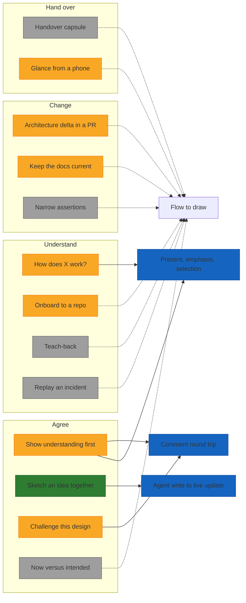

# Use cases

The jobs Archer serves, for its [intent](intent.md). **Intent** asks whether we want it (proposed
until confirmed). **Built** asks what the code does today. Nine came from a list
agreed to on 2026-10-22, but the wording is the agent's: rows stay proposed unless confirmed. The
first four were chosen to build (2026-10-22): how does X work, show understanding first, keep the docs
current, now versus intended.

| Case | When…, I want…, so… | Intent | Built | Shown by · code |
|---|---|---|---|---|
| How does X work? | I ask how a feature works; see the existing diagram, path emphasised; no prose | proposed | partly: presenting, emphasis and `docs_index` routing | present · `ts/src/docs/pack.ts#route` |
| Onboard to a repo | I open an unfamiliar repo; a tour where each claim points at code; I can trust it | proposed | partly | — · `ts/src/application/index.ts` |
| Teach-back | Both ways: I explain a flow back on the diagram and the agent checks it, or the agent explains and I check; see where we differ | confirmed 2026-10-22 | no | — |
| Replay an incident | Something broke; replay the failing path step by step; see where | proposed | no | — · `ts/src/service/emphasis.ts` |
| Show understanding first | I ask for a change; the agent shows how it sees that part and waits; I correct it before code | proposed | partly: presenting and comments, not the wait | [present](diagrams/flows/present-emphasis-selection.mmd), [comments](diagrams/flows/comment-round-trip.mmd) · `ts/src/comments/agent.ts` |
| Sketch an idea together | Thinking out loud; a one-off picture we change fast; settle it without a doc | proposed | yes | [live update](diagrams/flows/agent-write-live-update.mmd) · `ts/src/service/watch.ts` |
| Challenge this design | I have a design; the agent argues against it on the diagram; risks surface early | proposed | partly | [comments](diagrams/flows/comment-round-trip.mmd) |
| Now versus intended | Built and designed differ; see both and the difference; decide which is wrong | proposed | no | — |
| Architecture delta in a PR | I review a PR; changed diagrams before and after; review structure too | proposed | partly: one diagram at two commits | — · `ts/src/accuracy/compare.ts#compareDiagramCommits` |
| Keep the docs current | Code changes; the agent fixes or re-checks the docs on it; answers stay trustworthy | proposed | partly: staleness, pack health | write · `ts/src/accuracy/stale.ts#listStaleDiagrams` |
| Narrow assertions | A rule matters (content writes stay in the folder); stated once and checked on change | proposed | no | — · `ts/src/project/project.ts#writeConfined` |
| Handover capsule | I hand work over; a generated note linking the relevant docs and diagrams; the next agent starts aligned | confirmed 2026-10-22 | no | — |
| Glance from a phone | Away from the desk; a readable picture; I can follow along | proposed | partly | — · `ts/src/export/`, `ts/src/mcp/server.ts` |

## Decided (2026-10-22)

- First slice: how does X work, show understanding first, keep the docs current, now versus
  intended.
- Teach-back goes both ways; a handover capsule is a generated note, no new format.
