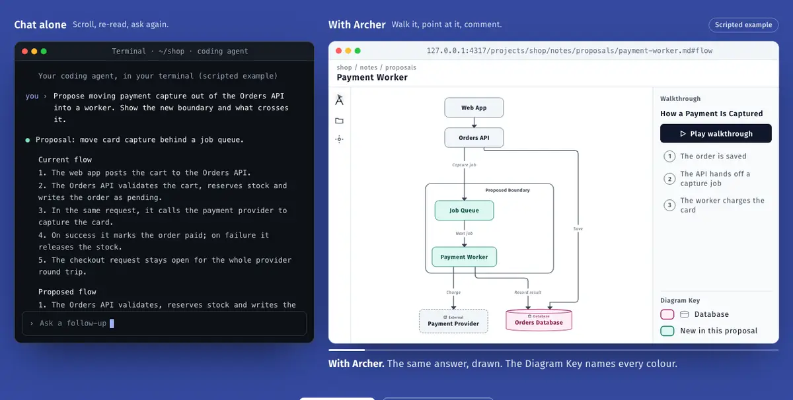

<div align="center">

# Archer

**Give your design conversation a shared picture.**

Your coding agent draws its answer as Mermaid diagrams and Markdown notes in your repo.<br>
Archer shows them in your browser, where you walk through them, point at the part you mean and comment.

[](https://github.com/chrisswanson/archer/actions/workflows/ci.yml)
[](https://github.com/chrisswanson/archer/releases/latest)
[](LICENSE)
[](https://nodejs.org/)
[](https://chrisswanson.github.io/archer/)

[**Docs**](https://chrisswanson.github.io/archer/install) ·
[**Try the playground**](https://chrisswanson.github.io/archer/playground/app/index.html) ·
[**Why Archer**](https://chrisswanson.github.io/archer/why) ·
[**Releases**](https://github.com/chrisswanson/archer/releases)

<br>

<picture>
  <source media="(prefers-color-scheme: dark)" srcset="docs/media/archer-film-dark.webp">
  
</picture>

<sub>A 30-second scripted example. <a href="docs/media/archer-film-light.mp4">Watch it as video</a>.</sub>

</div>

## Install

macOS or Linux (Windows through WSL), with Node 22.18 or newer:

```sh
curl -fsSL https://chrisswanson.github.io/archer/install.sh | sh
```

or, without the script:

```sh
npx -y https://github.com/chrisswanson/archer/releases/latest/download/archer.tgz setup
```

Setup installs the `archer` command and links the Archer skill into Claude Code and Codex. To
register its MCP server too, pass `--mcp` (`… | sh -s -- --mcp`). The
[install guide](https://chrisswanson.github.io/archer/install) covers versions, upgrades and what setup changes.

## Quick start

```sh
cd your-project
archer init
```

Start your coding agent in that folder and ask:

> Draw the containers of this project as a C4 diagram and show it to me.

The agent writes the diagram into `.archer/` and gives you a link. Open it, select the part you
mean and leave a comment. On your next turn the agent reads it, replies in the thread and revises
the drawing.

## What you can do

- **Follow a path.** Ask the agent to highlight a flow on an existing diagram, or replay a saved
  walkthrough step by step.
- **Review a proposal.** Put a proposed change beside the current design and comment on a single
  connection until you agree.
- **Point instead of describe.** Select a part, and your follow-up carries it as context.
- **Edit in the browser.** Add parts, connect and rename them, or edit the Mermaid beside the live drawing.
- **Keep the understanding.** Docs mode keeps a small architecture pack current, so the next
  conversation starts from the diagrams you already agreed on.

Diagrams are plain Mermaid files in your repo: flowchart, sequence, state, entity-relationship,
C4, architecture and user-journey diagrams ([what's supported](https://chrisswanson.github.io/archer/supported-mermaid/)).
Archer runs locally and adds no agent of its own.

## Documentation

| | |
|---|---|
| [Install](https://chrisswanson.github.io/archer/install) | Setup, upgrades, Windows through WSL |
| [Why Archer](https://chrisswanson.github.io/archer/why) | The problem it solves |
| [How it works](https://chrisswanson.github.io/archer/how-it-works) | The folder, the service, the agent's tools |
| [Usage](https://chrisswanson.github.io/archer/usage) | Day-to-day prompts and the review loop |
| [CLI reference](https://chrisswanson.github.io/archer/generated/cli) | Every `archer` command |
| [HTTPS and browser trust](https://chrisswanson.github.io/archer/security/network-access) | Opening Archer from another device |

## Contributing

Archer is TypeScript: `ts/` holds the service, CLI and MCP server, `ui/` the browser page.
[Developing Archer](docs/development.md) covers building and testing from a checkout,
[CONTRIBUTING.md](CONTRIBUTING.md) the pull-request flow, and [AGENTS.md](AGENTS.md) is the entry
point for coding agents working on Archer itself. Release notes are in [CHANGELOG.md](CHANGELOG.md).

Report vulnerabilities privately, as [SECURITY.md](SECURITY.md) describes.

## License

[Apache-2.0](LICENSE)
