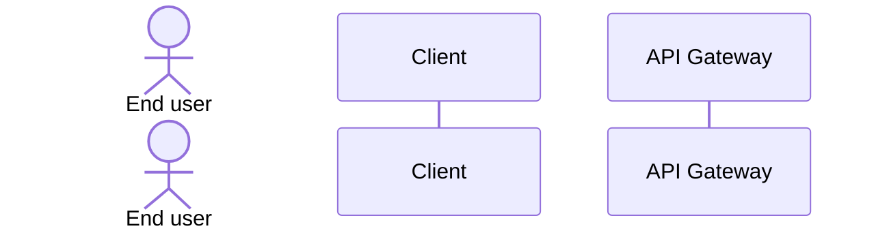
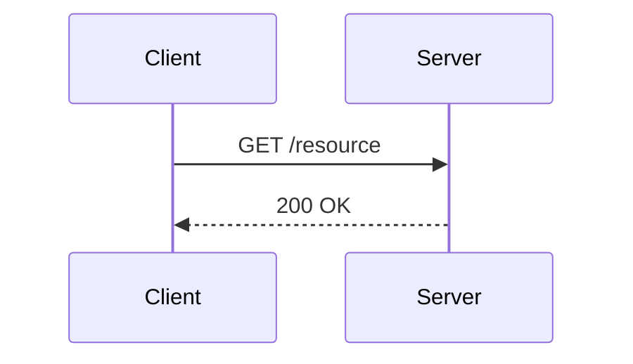
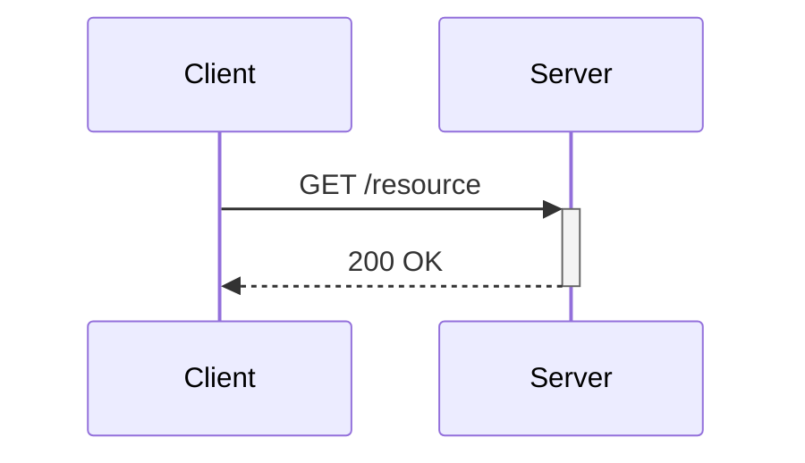
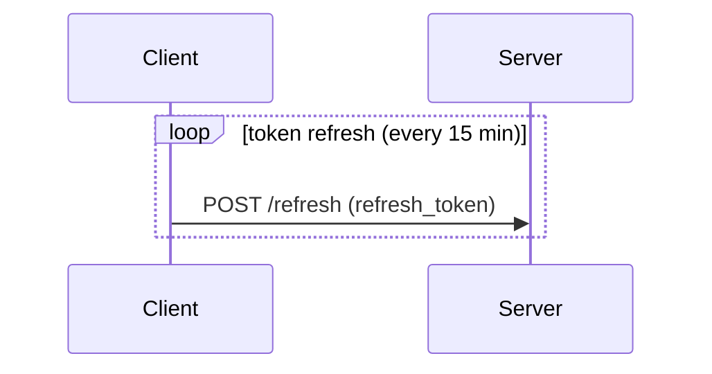
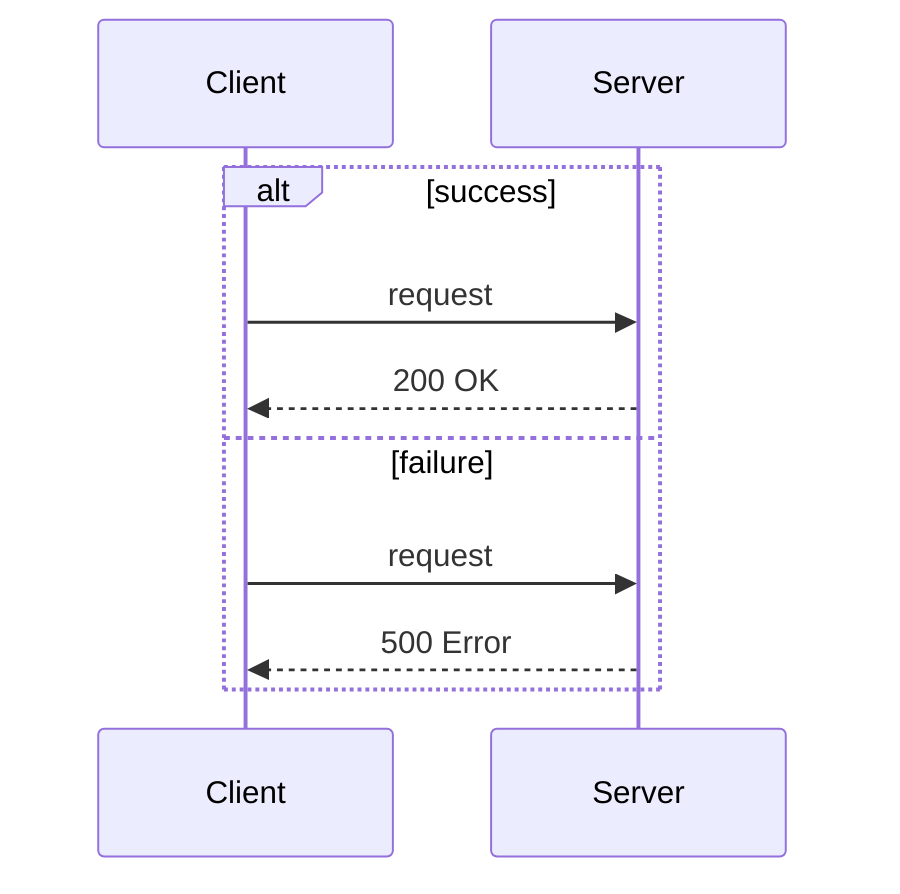
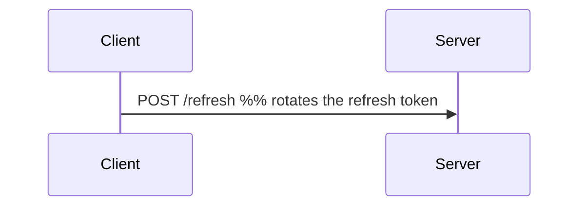

# Supported Mermaid flowchart profile

The flowchart parser accepts only `flowchart` or `graph` with direction `LR`, `RL`, `TB`, `TD`, or
`BT`. `TD` is an alias for `TB`, matching upstream Mermaid. Every node must be explicitly declared
with a stable ID and non-empty label. Anonymous edges and implicit node creation are rejected.
Blank lines and `%%` comment lines may precede the header.

Declaration order is significant in a flowchart: a node must be declared on an earlier line than
any edge or bare reference that names it. A use above the declaration is rejected with
`undeclared_node` at the use, exactly as if the node were never declared. (The sequence profile
below is looser: a participant may be declared anywhere in the file.)

A statement is one line, the header included. Nothing continues onto the next line: `flowchart`
without its direction, `subgraph` without its ID, an edge without its link or its target, and a
node ID without its shape are each rejected on their own line (`expected_direction`,
`expected_subgraph_id`, `expected_edge_op`, `expected_target_node`), whatever the following line
holds. When the following line opens with a shape or a `:::` class, which can only be the rest of
the statement above, that statement is rejected with `split_statement`.

The header direction is part of the model: it is emitted as `direction` on the graph model, spelled
`lr`, `rl`, `tb`, or `bt` (`TD` normalises to `tb`). The field is optional on the wire and its
absence means `tb`; a model compiled from Mermaid always carries it.

Node, edge, and subgraph IDs must each be unique: a second declaration is rejected with
`duplicate_node`, `duplicate_edge`, or `duplicate_subgraph` at the repeated ID. The three kinds are
separate namespaces, so a node may share an ID with a subgraph. To place an already declared node in
a subgraph, reference it by its bare ID inside the subgraph rather than declaring it again.

Supported node forms, with the `shape` each one emits:

| Syntax        | `shape`      |
|---------------|--------------|
| `id[Label]`   | `rectangle`  |
| `id(Label)`   | `rounded`    |
| `id([Label])` | `stadium`    |
| `id((Label))` | `circle`     |
| `id{Label}`   | `diamond`    |
| `id[(Label)]` | `cylinder`   |
| `id{{Label}}` | `hexagon`    |
| `id[[Label]]` | `subroutine` |

HTML labels, markdown string labels, and inline styling are not supported.

## Label text

A label is free text running from the opening delimiter to its matching terminator. Spaces,
commas, colons, hyphens, slashes, and parentheses are preserved verbatim; surrounding whitespace is
trimmed. Quoting is optional, and a single pair of double quotes wrapping the whole label is
stripped: `x[API (v2)]` and `x["API (v2)"]` both yield the label `API (v2)`.

Nested delimiters of the same kind must balance before the label terminates, so `x(API (v2))` and
`x[Bracket [inner]]` parse. An *unbalanced* delimiter must be quoted — `x(API (v2)` is an unclosed
label, `x("API (v2")` is the label `API (v2`.

A delimiter *immediately adjacent* to the opener is a shape marker, not label text. `x[(…)]`,
`x[[…]]`, and `x{{…}}` are the cylinder, subroutine, and hexagon above; `x(((…)))`, `x[/…/]`, and
`x[\…\]` name shapes outside the profile and are rejected with `unsupported_construct`. Adjacency
is the whole discriminator, so the nested-label forms above are unaffected: `x[Bracket [inner]]` is
still a rectangle. Quote the label to keep such text literal: `x["(Db)"]` is a rectangle labelled
`(Db)`.

A two-character shape closes on its two-character terminator, and the same balancing applies
inside it: `x[(Orders (primary))]` is a cylinder labelled `Orders (primary)`.

A label never spans a line. A missing terminator is reported as `expected_bracket_close`,
`expected_paren_close`, `expected_circle_close`, or `expected_brace_close`; an empty label is
`expected_label`.

`%%` inside a label's delimiters is literal text, not a comment; `%%` after the closing delimiter
starts a trailing comment, as anywhere else on a line.

Every edge has an explicit stable ID, is directed, and has one source and one target:

```mermaid
flowchart LR
  web[Web application]
  api[API]
  db[(Orders)]
  request@web -->|HTTPS| api
  reads@api -.->|on cache miss| db
  writes@api ==> db
```

The link operator sets the edge's `line`. A label, when present, goes between pipes after the
operator. The text between the pipes is a label like any other: it is trimmed, and one that is empty
or blank (`-->||`, `-->|  |`) is rejected with `expected_label`. Leave the pipes out for an edge with
no label.

| Operator | `line`                           |
|----------|----------------------------------|
| `-->`    | `solid` (the default; not emitted) |
| `-.->`   | `dotted`                         |
| `==>`    | `thick`                          |

Longer operators of the same family (`--->`, `-..->`, `===>`) are accepted and mean the same line;
length carries no meaning in the model.

Nested groups use `subgraph group_id[Label]` followed by `end`. The label obeys exactly the same
rules as a node label, so `subgraph backend[Backend services (core)]` is accepted. Omitting
`[Label]` uses the group ID as the label. Groups are not selectable in V1.

Subgraphs may nest at most 24 levels deep. A `subgraph` opened inside 24 others is rejected with
`subgraph_nesting_too_deep` at that `subgraph` keyword, and checking of the source stops there: what
follows is inside a group that was never opened, so nothing after it is reported. The limit is the
same number as the sequence profile's fragment limit below, and exists for the same reason — a
diagram stays cheap to validate and lay out, and its envelope stays readable by a default JSON
parser.

The supported semantic classes are `person`, `system`, `container`, `component`, `database`, and
`external`; unknown classes are diagnostics.

## Rejected flowchart constructs

`%%` line comments are supported. Everything below is rejected with `unsupported_construct`, and
every such diagnostic names the supported syntax to write instead:

- unlisted shapes: `(((…)))` double circle, `[/…/]` and `[\…\]` parallelogram/trapezoid, `>…]`
  asymmetric
- a node shape as a subgraph label (`subgraph g[(Store)]`): write `subgraph id[Label]`
- HTML in labels (including `<br>`) and markdown string labels
- YAML frontmatter (`---`) and `%%{init}%%` directives
- `click`, `class`, `classDef`, `style`, `linkStyle`, and `direction` statements
- undirected and open links (`---`, `-.-`, `===`) and invisible links (`~~~`)
- cross and circle link ends (`--x`, `--o`, `-.-x`, `-.-o`, `==x`, `==o`): write the directed link
  of the same family and put what the ending meant in the label, `edge_id@a -->|fails| b`
- bidirectional links (`<-->`, `<-.->`, `<==>`): write two edges, each with its own ID
- inline link text (`-- text -->`, `-. text .->`, `== text ==>`): write the label between pipes,
  `edge_id@source -->|text| target`
- anonymous edges (`a --> b`, `a -.-> b`, `a ==> b`), chained edges (`a --> b --> c`), and `&` node
  chaining
- inline node declarations inside an edge (`e1@a[Client] --> b[API]`): declare each node on its own
  line first. Mermaid's default `A[Client] --> B[API]` is both mistakes at once, and its one
  diagnostic names both: the missing edge ID and the inline declarations
- a subgraph or group ID as an edge endpoint: connect to a node inside the group
- a subgraph title without an ID, bare or quoted (`subgraph Backend Services`,
  `subgraph "Backend Services"`): write `subgraph id[Label]`
- more than one class on a node (`a[Web]:::system:::external`)
- a trailing `;` on the header or a statement
- all other Mermaid constructs

The keyword statements above are recognised only at the start of a statement and only when followed
by whitespace, so `click[Click]` is still an ordinary node declaration.

## Diagnostics

Every syntax error carries a source span that starts on the offending line. The same holds for the
sequence profile below, as does the rest of this section.

A source with several problems gets all of them in one report, in source order, so they can be
fixed in one pass: `validate_diagram`, `write_diagram`, and a refused `register_diagram` each list
every one as `[code] line L:C: message`. No model is produced while any problem stands. After a
statement that does not parse, checking resumes at the next line. The report has three limits:

- A consequence of an earlier problem is not reported as a problem of its own. A reference to a
  node whose own declaration line was rejected, the `end` of a `subgraph` or of a rejected `rect`,
  `critical`, `break` or `box` block, the `option` sections of a rejected `critical`, a second use
  of the same undeclared node or participant, and a `deactivate` after a rejected line that would
  have opened the activation are all left out.
- A source with no diagram header (`expected_flowchart`), or one whose header names a Mermaid type Archer
  does not draw (`classDiagram`, `gantt`, `C4Code`: `unsupported_diagram_type`), gets that one problem: there is nothing to
  check the rest against. YAML frontmatter is one problem however many lines it holds, and the
  diagram below it is still checked.
- At most 20 problems are listed. A longer report ends with one `too_many_diagnostics` entry that
  points at the first problem left out. It does not say how many there are: checking stops when the
  report is full, so the rest of the source is not read and the number is not known. `archer validate` counts
  the errors listed (20) and says `20 errors shown, more remain`; the marker itself is not counted. For the same
  reason a full report never lists a block as unclosed (`unclosed_subgraph`, `unclosed_fragment`):
  that is only known at the end of the source.

On a line the lexer cannot read to its end, its diagnostic is the only one for that line.

A warning leaves the diagram valid and carries a span as well. There are two, both flowchart-only:
`unknown_class`, at the class name, for a class outside the six above; and `unconnected_node`, at
the node's declaration, for a node with no edge in a diagram that has at least one edge.

Archer frontmatter is deferred; manifest metadata is authoritative in V1.

# Supported Mermaid sequence diagram profile

The sequence parser accepts `sequenceDiagram` as the header keyword (no direction parameter).
Blank lines and `%%` comment lines may precede the header.

## Participant declarations

Participants are declared with `participant id as Label` or `actor id as Label`. Every participant
named by a message, a note, or an `activate`/`deactivate` must be declared somewhere in the file;
one that never is is rejected with `undeclared_participant` at the use. The declaration may sit
anywhere, including below the first use: order alone is never an error, and participants appear in
the model in declaration order. The two keywords share one namespace and one set of
rules; `actor` additionally emits `kind: "actor"` on the participant (the default kind,
`participant`, is not emitted). Declaring the same ID twice, with either keyword, is rejected with
`duplicate_participant`.

`actor` is a keyword only at the start of a statement and only when followed by whitespace, so a
participant may be named `actor`.

The alias after `as` is free text running to the end of the line, exactly like the message text
after a colon: punctuation is preserved verbatim, surrounding whitespace is trimmed, and a `%%`
outside a quoted span starts a trailing comment. A single pair of double quotes wrapping the whole
alias is stripped, as for flowchart node labels, so `participant web as "Web (EU)"` and
`participant web as Web (EU)` both yield the label `Web (EU)`. An empty alias is rejected with
`expected_label`. `as` introduces an alias only in `participant id as` and `actor id as`, and
nothing in the alias is a keyword: `participant web as Note taker` is the label `Note taker`.



## Message types

Messages use the following arrow syntax between participant IDs:

| Arrow   | Meaning          |
|---------|------------------|
| `->>`   | sync message     |
| `-->>`  | reply / response |
| `-)`    | async message    |

Message text follows the colon after the target participant:



## Activation and deactivation

Explicit activation and deactivation of participant lifelines:

```
activate participant_id
deactivate participant_id
```

Activations may stack: a second `activate` on an already active participant is legal, and an
activation may be left open at the end of the diagram. A `deactivate` needs an open activation on
the same participant earlier in the source; otherwise it is rejected with `unmatched_deactivate`.

### Activation shorthand

A `+` or `-` directly after any of the three arrows is shorthand, desugared by the parser into the
explicit events above. The model has no separate representation for it.

- `a->>+b: text` is the message followed by `activate b`: `+` activates the **receiver**.
- `b-->>-a: text` is the message followed by `deactivate b`: `-` deactivates the **sender**, as in
  Mermaid.

The shorthand and the explicit statements share one count of open activations per participant, so
either may close what the other opened. A `-` whose sender has no open activation is rejected with
`unmatched_deactivate`, exactly like an unmatched `deactivate` statement.



## Notes

A note is free text attached to one or two participants. It becomes a `note` event in the trace, in
source order alongside messages and fragments, and may appear inside a fragment section.

| Syntax                  | `position` | `participants` |
|-------------------------|------------|----------------|
| `Note left of a: text`  | `left-of`  | `["a"]`        |
| `Note right of a: text` | `right-of` | `["a"]`        |
| `Note over a: text`     | `over`     | `["a"]`        |
| `Note over a,b: text`   | `over`     | `["a", "b"]`   |

`Note`, `left of`, `right of`, and `over` are matched case-insensitively, as in Mermaid. Each note
gets a positional ID `note-N`, counted from zero in source order independently of the `msg-N` and
`frag-N` counters. Note IDs are not focus or emphasis targets.

The text follows the same rules as message text: it runs to the end of the line, is trimmed, keeps
its punctuation, and ends at a `%%` outside a quoted span. It is required: an empty note is
`expected_label`, and a missing colon is `expected_colon`.

Every participant a note names must be declared; otherwise the note is rejected with
`undeclared_participant` at that name. `left of` and `right of` take exactly one participant and
`over` takes one or two; any other count, or a position other than those three, is `invalid_note`.

`Note` is a keyword only at the start of a statement and only when followed by whitespace, so a
participant may be named `note` (`note->>b: hello`).

## Message numbering

A bare `autonumber` statement sets `autonumber: true` on the trace (the field is omitted when the
source has no such statement). It records that the author wants messages numbered; the numbers are
positional and are not stored, and `msg-N` IDs are unaffected.

Only the bare keyword is accepted. `autonumber 10`, `autonumber 10 5`, and `autonumber off` are
rejected with `unsupported_construct`.

## Fragment types

Supported combined fragments:

| Fragment       | Syntax                             |
|----------------|-------------------------------------|
| Loop           | `loop label` ... `end`             |
| Alternative    | `alt label` ... `else label` ... `end` |
| Optional       | `opt label` ... `end`              |
| Parallel       | `par label` ... `and label` ... `end` |

Fragments may nest, at most 24 levels deep. A fragment opened inside 24 others is rejected with
`fragment_nesting_too_deep` at its keyword, and checking of the source stops there. The limit keeps
the parser's stack bounded and keeps the envelope inside the nesting a default JSON reader accepts
(each fragment level costs several levels of JSON). Each fragment keyword is followed by a label.
`else` and `and` are continuation keywords within their respective fragments.

A fragment or section label is free text running to the end of the line, exactly like the message
text after a colon. Punctuation such as parentheses, slashes, and commas is preserved verbatim;
surrounding whitespace is trimmed. As with message text, a `%%` outside a quoted span ends the label
and starts a trailing comment. An empty label is rejected: every fragment keyword requires a label.





## Comments

`%%` line comments are supported, matching the flowchart profile. A `%%` is also recognised at the
end of a message, note, or fragment label, where it starts a trailing comment:



Because sequence labels run to the end of the line rather than to a closing delimiter, quoting is
what makes a `%%` literal: `a->>b: "100 %% pure"` keeps the whole text, quotes included. A single
`%` is always literal, so `a->>b: 100% complete` needs no quoting.

## Rejected constructs

The following Mermaid sequence constructs are rejected with `unsupported_construct`. Rejection is
hard: the source does not compile and `validate_diagram` reports `valid: false`. The construct is
never dropped from the model while the diagram is reported as valid.

- `rect` background highlighting
- `autonumber` with a start value, a step, or `off` (the bare keyword is supported)
- `link` and `links` URL attachments
- `create` / `destroy` participant lifecycle
- `critical` / `option` / `break` fragment types
- `box` participant grouping
- arrows other than `->>`, `-->>`, and `-)`: open arrows (`->`, `-->`), cross arrows (`-x`, `--x`),
  the dotted async arrow (`--)`), and bidirectional arrows (`<<->>`, `<<-->>`)
- `else` inside `par` (use `and`) and `and` inside `alt` (use `else`)
- `%%{init}%%` directives, anywhere a comment could start: on a line of their own, after a statement,
  or after message, note, or fragment text. They are not comments and are never silently skipped
- Style directives and theming

Each of these is a keyword only at the start of a statement and only when followed by whitespace, so
a participant may still be named `rect` or `box`.

# Limits

Both profiles share these bounds. Each one is a refusal with a diagnostic of its own that says what
the bound is and what to do; nothing is ever cut to fit.

| What | At most | Diagnostic |
|------|---------|------------|
| The source of one view | 262,144 bytes (256 KiB) of UTF-8 | `source_too_large` |
| One label | 512 characters | `label_too_long` |
| Nested subgraphs; nested fragments | 24 levels | `subgraph_nesting_too_deep`; `fragment_nesting_too_deep` |
| One ID | 128 characters | `invalid_id` |

A label is any free text the profile draws: a node, edge or subgraph label, a participant alias, the
text of a message or a note, and a fragment or section label. It is measured in characters after
trimming and after a surrounding pair of quotes is removed, so a label in a script that takes
several bytes a character has the same room as one in ASCII. `label_too_long` is reported at the
label, and the rest of that line is not checked.

A source over the size limit is not read at all. `source_too_large` is then the only problem
reported, at the first line, whatever else the source holds. The largest diagram that is still
readable on screen is a few hundred nodes, which is about a tenth of the limit: a source that
reaches it wants to be several views.

The earlier Rust implementation also bounded what a tool call may carry and how many views a
workspace may register: any ID 128 characters, a presentation annotation 500 characters, 256 ids
in each focus list, 1024 nodes and 1024 edges in a selection, and 256 views in one workspace.
