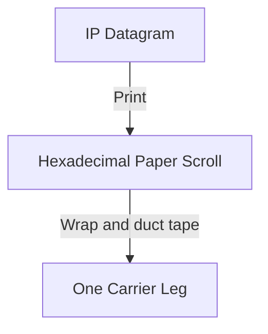
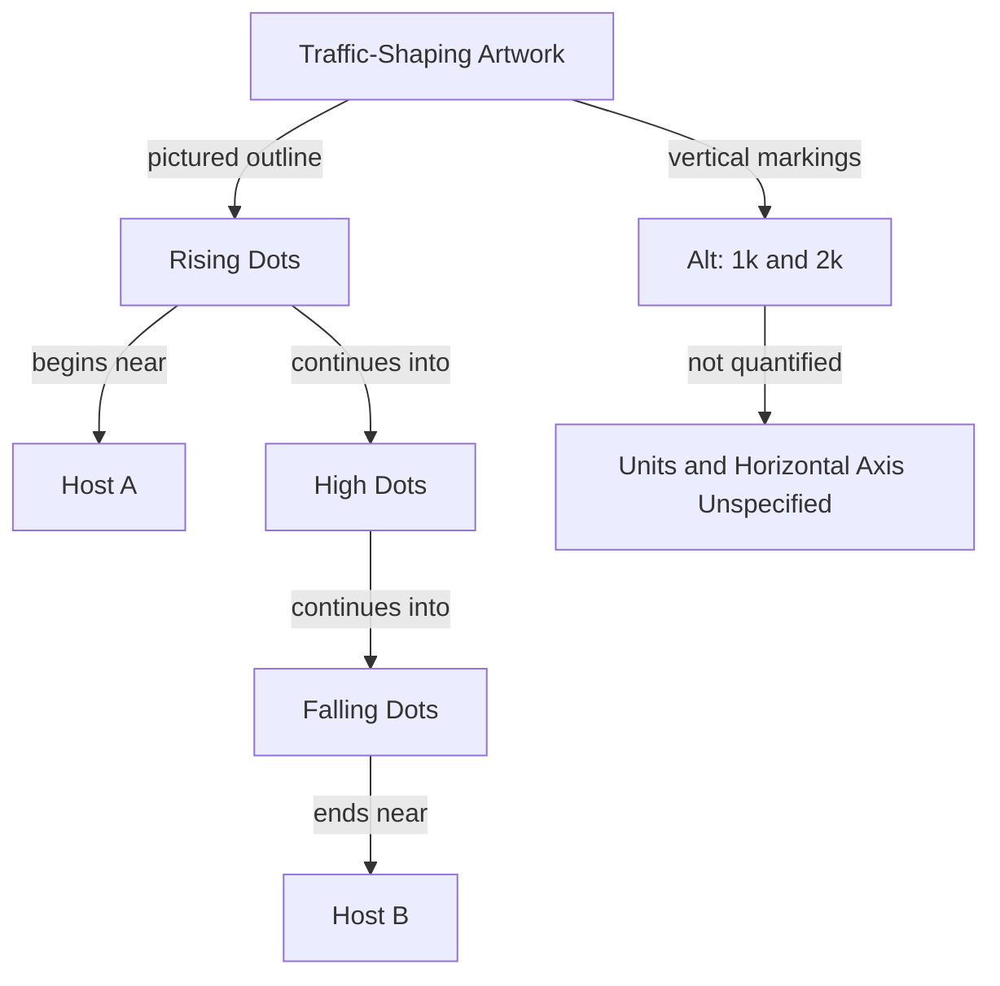

# Protocol Casebook: Packets With Wings

A wing mark can place a carrier in a queue. Does it tell us when that carrier can leave?
This agent-authored casebook reads RFC 1149 and RFC 2549 through two questions: what the queue permits and what the traffic picture shows.

Keep [RFC 1149](rfc1149.md) and [RFC 2549](rfc2549.md) beside this explanation. Their wording and artwork are preserved; challenge the interpretation here and improve it with your agent.

## When can a carrier leave?

In the queue strategy described by RFC 2549, scanning a wing gets a carrier into its class queue. The gate holds it until the “proper time.” The memo never tells us how to calculate that time.

Open [A Pecking Order With Queues](../diagrams/qos-queues.mmd), choose **Walkthrough**, then **From wing mark to departure**. Follow the class assignment through the gate; the final step shows where the explanation must stop.

| What the figure names | What the source supports |
| --- | --- |
| Wing Bar Code → Bar-Code Reader | Service level is marked on each carrier's wing. |
| Service Level → class queue | One implementation strategy scans on entry and enqueues in the proper queue. |
| Gated Queue → Departure | Exit is prevented until the proper time. No release formula is given. |
| RED Paint / Scales for WFQ | Optional mechanisms while enqueued; no deletion procedure or weight calculation is specified. |

Exact excerpt — **RFC 2549, Overview and Rational** (the original sections are unnumbered):

> The service level is indicated on a per-carrier basis by bar-code
> markings on the wing.  One implementation strategy is for a bar-code
> reader to scan each carrier as it enters the router and then enqueue
> it in the proper queue, gated to prevent exit until the proper time.
> The carriers may sleep while enqueued.

**Agent interpretation:** the four queue boxes apply this strategy to the four service levels named in the preceding paragraph: Concorde, First, Business and Coach. They are explanatory boxes, not proof of a strict-priority scheduler. The dotted branches show optional queue mechanisms, not steps after departure.

**Gap:** “proper time” supplies a condition without an algorithm. We cannot derive a departure interval, fairness guarantee or throughput from it. RFC 2549's **Specification of Requirements** also uses its own satirical definitions of MAY and MUST; keep those definitions with this reading.

**Challenge your agent:** “Show me the source for the `depart` edge's release condition. Does this diagram accidentally promise strict priority? Select the edge, explain the missing scheduling decision, and propose any implementation policy as hypothetical.” Open the diagram, select **Proper time**, and leave a real comment with the assumption you want checked.

### What is actually being carried?

This compact figure identifies the physical representation described in **RFC 1149, Frame Format**. Open it for the full canvas; [One Datagram Takes Flight](../diagrams/datagram-flight.mmd) supplies the surrounding sequence.



Exact excerpt — **RFC 1149, Frame Format**:

> The IP datagram is printed, on a small scroll of paper, in
> hexadecimal, with each octet separated by whitestuff and blackstuff.
> The scroll of paper is wrapped around one leg of the avian carrier.
> A band of duct tape is used to secure the datagram's edges.  The
> bandwidth is limited to the leg length.  The MTU is variable, and
> paradoxically, generally increases with increased carrier age.  A
> typical MTU is 256 milligrams.  Some datagram padding may be needed.

This is a representation-and-attachment explanation. It adds no normative byte layout, packet header, acknowledgement or OCR algorithm. The variable MTU is measured in milligrams in the memo; it is not a byte count.

## What does the traffic picture actually show?

It depicts carriers between A and B with an `Alt` axis marked `1k` and `2k`. It provides neither a horizontal-axis label nor units. Read it as a scene before treating it as data.



Exact figure — **RFC 2549, Overview and Rational**, immediately after “The following is a plot of traffic shaping, from coop-erative host sites.”:

```text
        Alt |       Plot of Traffic Shaping showing carriers in flight
            |
         2k |           ....................
            |          .                    .
            |         .                      .
         1k |        .                        .
            |   +---+                          +---+
            |   | A |                          | B |
            |   +---+                          +---+
            |_____________________________________________
```

**Agent interpretation:** dots rise from near A, run across a high section near the `2k` mark, then fall toward B. The arrows above trace parts of that drawn outline, not packet transfers or a delivery guarantee. The `Alt` marks relate the low and high portions vertically. Nothing labels the horizontal direction as time or distance. The joke gives traffic a physical shape; it supplies no numerical traffic model.

### What do the WFQ scales compare?

In the separate scales artwork, two 10g weights sit on one side of a balance, with a carrier on the other side. The beam and fulcrum put the weights and bird in a physical comparison: the “weighted” in weighted fair queueing becomes literal weighing. Small marks on the scale illustrate the following sentence's “log entries” from carriers waiting too long.

| Pictured relationship | What it leaves open |
| --- | --- |
| Two stacked 10g blocks opposite a carrier | The weights are labelled; the carrier's mass and any payload mass are not. |
| Both sides rest on a beam over a fulcrum | No calibrated measurement or equality is stated. |
| Scales may implement WFQ while carriers wait | There is no weight-to-priority formula, service share or release interval. |
| Marks on the scale become “log entries” | The pun supplies no logging format or queue-age threshold. |

Open [the preserved artwork](rfc2549.md#overview-and-rational) to compare the beam, carrier and marks. This scales joke concerns queued carriers; it does not explain the traffic outline or fill in the gate's missing scheduling policy.

**Gap:** the drawing gives no flight duration, speed, altitude units, departure times or delivery guarantee. Even a smooth-looking curve supplies none of those missing definitions.

**Challenge your agent:** “Open this scene and select `vertical_axis`. Which quantities does the source label, and which remain unknown? Compare the scales: can its labelled weights establish any scheduling policy?” Or select the sentence above and leave a passage comment naming the claim you want narrowed. Improve this derivative explanation; preserve the original figure.

## Try the interaction

From this project directory, with Archer running, load the queue highlight recipe:

```sh
archer emphasis set --file demo/emphasis/queue-release.json
```

Open [A Pecking Order With Queues](../diagrams/qos-queues.mmd) and choose **Highlights**. The marks isolate the gate and release condition. Ask your agent to explain why **Proper time** is a source phrase rather than a timer, then select that edge and comment on the assumption you would need for implementation.

For the physical trip, load:

```sh
archer emphasis set --file demo/emphasis/datagram-flight.json
```

Open [One Datagram Takes Flight](../diagrams/datagram-flight.mmd) and choose **Highlights**. Ask your agent to show **Carry datagram**, then explain why that message does not prove reliable delivery. The recipe targets that exact message; it is not a saved sequence walkthrough. Sequence and journey diagrams cannot host walkthroughs today. The saved queue route runs on a graph.

The public site shows static figures and walkthrough prose. Run these commands in the local Archer project to try selection, highlights and real comments.

## Continue with the official documents

Read [RFC 1149 in full](rfc1149.md) and [RFC 2549 in full](rfc2549.md). Use their tables of contents for the section headings cited above. The reproductions and original plain-text files remain fixed; these cases are agent-authored interpretation.

- [The Three-Dimensional Ether](../diagrams/avian-link.mmd): physical path, not extra network infrastructure.
- [Delivery Until the Carrier Drops](../diagrams/carrier-states.mmd): explanatory outcomes, including loss and messy hawk decapsulation; no invented retry timer.
- [Carrier Choices and Cautions](../diagrams/carrier-cautions.mmd): independent bulk-transfer and routing cautions.
- [A Packet Has a Flight](../diagrams/packet-day.mmd): a successful itinerary; its 1–5 scores are editorial whimsy, not measurements or guarantees.

## Copyright and permission

RFC 1149's Status of this Memo says distribution is unlimited. The following is RFC 2549's full applicable statement. Exported figures, walkthrough sidecars and recipes must travel with [the project notice](../../NOTICE.md); Mermaid comments alone do not put a notice into an image.

   Copyright (C) The Internet Society (1999).  All Rights Reserved.

   This document and translations of it may be copied and furnished to
   others, and derivative works that comment on or otherwise explain it
   or assist in its implementation may be prepared, copied, published
   and distributed, in whole or in part, without restriction of any
   kind, provided that the above copyright notice and this paragraph are
   included on all such copies and derivative works.  However, this
   document itself may not be modified in any way, such as by removing
   the copyright notice or references to the Internet Society or other
   Internet organizations, except as needed for the purpose of
   developing Internet standards in which case the procedures for
   copyrights defined in the Internet Standards process must be
   followed, or as required to translate it into languages other than
   English.

   The limited permissions granted above are perpetual and will not be
   revoked by the Internet Society or its successors or assigns.

   This document and the information contained herein is provided on an
   "AS IS" basis and THE INTERNET SOCIETY AND THE INTERNET ENGINEERING
   TASK FORCE DISCLAIMS ALL WARRANTIES, EXPRESS OR IMPLIED, INCLUDING
   BUT NOT LIMITED TO ANY WARRANTY THAT THE USE OF THE INFORMATION
   HEREIN WILL NOT INFRINGE ANY RIGHTS OR ANY IMPLIED WARRANTIES OF
   MERCHANTABILITY OR FITNESS FOR A PARTICULAR PURPOSE.
