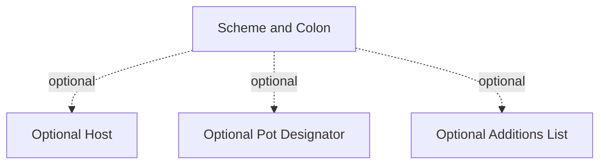
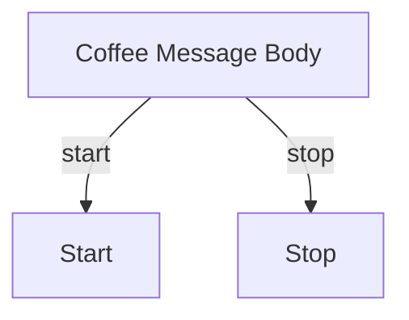

# Protocol Casebook: Coffee

A request can name a pot and ask for milk. Does that mean the pot can supply it?
These two cases separate the address, the command and the refusal. This is an agent-authored explanation of Larry Masinter's April 1, 1998 RFC 2324, an Informational memo. It does not specify an Internet standard.

Keep the [official RFC](rfc2324.md) beside this casebook; its wording is preserved. Use that note's table of contents for the numbered sections. The living document here is the interpretation: challenge it, then improve it with your agent.

## What does this request name?

**Agent interpretation:** §3 writes a scheme and colon, followed by three independently optional slots. A host identifies the destination; a pot-designator can distinguish pots on that machine; an additions-list asks for extras. Naming an extra does not establish that it is available.



Each dotted branch is an independent choice; none requires either of the other optional slots. The grammar below gives their written order. Open it for the full canvas, or use [Anatomy of a Coffee URI](../diagrams/coffee-uri.mmd) to inspect containment and optionality.

Exact excerpt — RFC 2324 §3, “The coffee URI scheme”:

```text
coffee-url  =  coffee-scheme ":" [ "//" host ]
                ["/" pot-designator ] ["?" additions-list ]
```

| Slot | Written form in §3 | What it establishes |
| --- | --- | --- |
| Scheme | `coffee-scheme ":"` | A listed spelling followed by a colon. |
| Host | `[ "//" host ]` | An optional host. |
| Pot | `["/" pot-designator ]` | An optional pot on a multi-pot machine. |
| Additions | `["?" additions-list ]` | An optional list, without invented `key=value` parameters. |

Exact excerpt — RFC 2324 §3:

```text
   pot-designator = "pot-" integer  ; for machines with multiple pots
   additions-list = #( addition )
```

**Gap:** the RFC supplies no production for `addition`. Its multilingual scheme list also contains malformed quoted and encoded spellings. The official note retains them; this figure neither repairs the grammar nor acts as a validator. The bracketed host, pot and additions slots are optional independently.

**Challenge your agent:** “Open the URI figure and highlight the optional slots. Can a URI name a pot without naming a host? Show the exact §3 evidence for your answer.” Select a branch in the full canvas and comment on its meaning, or select this passage and leave a passage comment.

## Which additions can the pot refuse?

**Agent interpretation:** §2.2.2.1 names families of additions; §2.3.1 permits a 406 response when the operator cannot comply. That is a choice the RFC allows, not a mandatory rejection algorithm. An address, an acceptable addition and an available ingredient are different things.

Exact excerpt — RFC 2324 §2.2.2.1, “The Accept-Additions header field”:

```text
       Accept-Additions = "Accept-Additions" ":"
                          #( addition-range [ accept-params ] )
```

| Alternative named by `addition-type` | Values in §2.2.2.1 |
| --- | --- |
| `*` | Wildcard literal |
| `milk-type` | Cream; Half-and-half; Whole-milk; Part-Skim; Skim; Non-Dairy |
| `syrup-type` | Vanilla; Almond; Raspberry; Chocolate |
| `sweetener-type` | Named; no production supplied |
| `spice-type` | Named; no production supplied |
| `alcohol-type` | Whisky; Rum; Kahlua; Aquavit |

Exact excerpt — RFC 2324 §2.3.1:

> This return code is normally interpreted as "The resource identified
> by the request is only capable of generating response entities which
> have content characteristics not acceptable according to the accept
> headers sent in the request. In HTCPCP, this response code MAY be
> returned if the operator of the coffee pot cannot comply with the
> Accept-Addition request. Unless the request was a HEAD request, the
> response SHOULD include an entity containing a list of available
> coffee additions.

[Coffee Conversations](../diagrams/coffee-conversations.mmd) shows the optional 406 exchange, the separate teapot refusal and a separate WHEN scene. No response encoding is inferred.

| Situation | RFC treatment | Limit of the explanation |
| --- | --- | --- |
| Operator cannot supply additions | 406 MAY be returned (§2.3.1) | No mandatory rejection policy. |
| Non-HEAD request receives 406 | Available additions SHOULD accompany it (§2.3.1) | No wire encoding is supplied. |
| Teapot is asked to brew coffee | Should result in 418 (§2.3.2) | A separate vessel problem. |
| Enough milk has been poured | Say WHEN (§2.1.4) | Not the command body's `stop` alternative. |

### What belongs in the body?

The compact figure keeps §4's body vocabulary separate from the additions header. Its two branches are alternatives, not a transcript or a sequence of commands.



Exact excerpt — RFC 2324 §4, “The message/coffeepot media type”:

```text
   coffee-message-body = "start" | "stop"
```

**Gap:** §2.1.1 names `application/coffee-pot-command`, while §4 requires `message/coffeepot`. The header names `addition-range` but defines `addition-type`; §2.3.1 uses the singular `Accept-Addition`. Sweetener and spice productions are missing. HTTP's list notation and optional `accept-params` do not fill those holes. A plausible complete wire request would silently choose answers the source does not give.

Open [Brew Decisions](../diagrams/brew-decisions.mmd) and choose the saved walkthrough **A Request Is Not a Promise**. It follows the body, the vessel and the optional refusal while keeping the media-type conflict visible. Its arrangement is for reading; the RFC does not prescribe this validation order.

**Challenge your agent:** “Highlight the optional 406 response in Coffee Conversations. Prove that MAY has not become MUST. Then show why WHEN is a different operation from `stop`, and identify the unresolved Content-Type choice before proposing any implementation.” Select the refusal line or the gap paragraph and leave a real comment for the agent to address.

### Try the interaction

Run these from this example's project directory with Archer attached. On the site these are instructions for the local app; the pictures here are static.

Open [Brew Decisions](../diagrams/brew-decisions.mmd), then run:

```sh
archer emphasis set --file demo/emphasis/optional-refusal.json
```

Or ask your agent to **open Brew Decisions and highlight the unavailable-additions choice and its optional 406 branch, explaining why refusal is permitted rather than required**.

Open [Coffee Conversations](../diagrams/coffee-conversations.mmd), then run:

```sh
archer emphasis set --file demo/emphasis/refusal-exchange.json
```

Or ask your agent to **highlight only the additions request and its 406 reply; keep the teapot and WHEN scenes separate**. The highlights isolate that request and reply. Highlighting points; it does not scroll the note or create a comment.

## Keep Reading

[Coffee Controls](../diagrams/coffee-controls.mmd) models `start` and `stop` as conceptual states; startup state, completion and repeated-command behavior are unspecified. [Coffee Across Firewalls](../diagrams/coffee-across-firewalls.mmd) explains §5.2's path through a home firewall, without adding a proxy. The RFC acknowledges required configuration changes; its earlier “no firewalls” claim is part of the joke, not deployment advice.

## Copyright and Permission

RFC 2324's full applicable statement follows. Keep it with this explanatory derivative. The project [distribution notice](../../NOTICE.md) also covers exported figures, walkthroughs and recipes.

   Copyright (C) The Internet Society (1998).  All Rights Reserved.

   This document and translations of it may be copied and furnished to
   others, and derivative works that comment on or otherwise explain it
   or assist in its implementation may be prepared, copied, published
   and distributed, in whole or in part, without restriction of any
   kind, provided that the above copyright notice and this paragraph are
   included on all such copies and derivative works.  However, this
   document itself may not be modified in any way, such as by removing
   the copyright notice or references to the Internet Society or other
   Internet organizations, except as needed for the purpose of
   developing Internet standards in which case the procedures for
   copyrights defined in the Internet Standards process must be
   followed, or as required to translate it into languages other than
   English.

   The limited permissions granted above are perpetual and will not be
   revoked by the Internet Society or its successors or assigns.

   This document and the information contained herein is provided on an
   "AS IS" basis and THE INTERNET SOCIETY AND THE INTERNET ENGINEERING
   TASK FORCE DISCLAIMS ALL WARRANTIES, EXPRESS OR IMPLIED, INCLUDING
   BUT NOT LIMITED TO ANY WARRANTY THAT THE USE OF THE INFORMATION
   HEREIN WILL NOT INFRINGE ANY RIGHTS OR ANY IMPLIED WARRANTIES OF
   MERCHANTABILITY OR FITNESS FOR A PARTICULAR PURPOSE.
