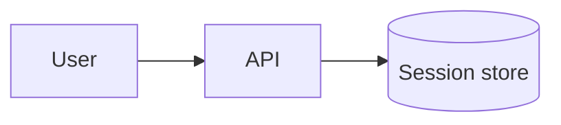
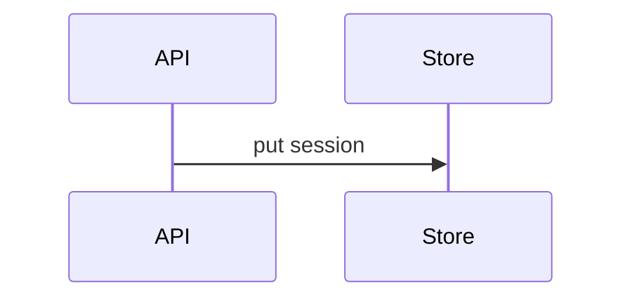
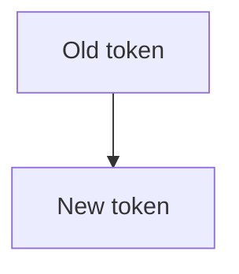
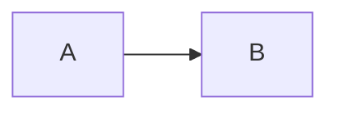

# Auth design

The login path keeps the token server-side.

## Login flow



The second view of the same flow, from the API's side:



## Tokens



- A diagram nested in a list is drawn, and read only:

  ```mermaid
  flowchart LR
    x["X"]
  ```

## Broken



A code block that is not Mermaid stays code:

```ts
const token = "server-side";
```
