# Supported Mermaid

Archer accepts a subset of real Mermaid: every diagram Archer accepts parses in Mermaid itself
(the version `ts/package.json` pins, 12.2.0), and a test runs every example on this page through it. Where this
page and Mermaid differ, the difference is a refusal on Archer's side, never a different reading of
the same text.

## Presentation: structure, data and order

Choose the question before the notation. C4 describes structure at a named level; Level 3
decomposes one real container into components. A flowchart can show processing stages and data
movement; a sequence shows ordered interactions in a concrete scenario. A proposal can put
complementary named blocks in one Markdown note, reusing component names. One view is enough
when it answers the question; preserve an explicit request for one diagram or for detailed C4.

Keep names short, descriptions focused on responsibilities and arrows specific. Keep real
boundaries: an internal component is not another service, and a local folder is not a database.
Do not invent technologies, retry policies or storage to fill the picture. Put rationale and open
decisions in the note. C4's technology and description arguments are different fields.

For example, the architecture and data-flow views of the same small worker answer different
questions. The architecture's Reads documents arrow points toward a dependency; the flow's
Documents arrow follows the data in the opposite direction.

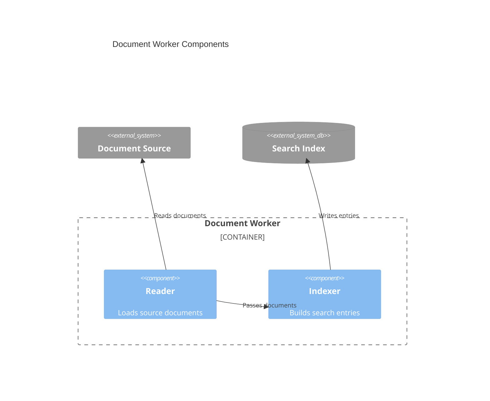

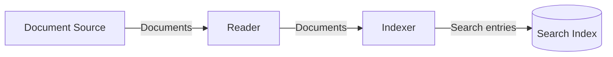

When request/response order is itself relevant, use a sequence instead of making the structural
view narrate every step. Add it only when useful, with the same names:

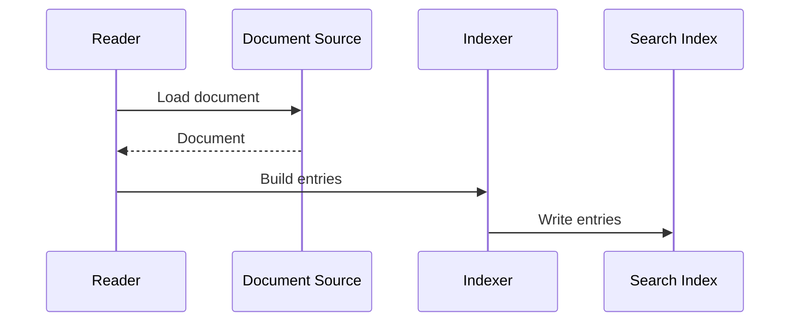

The official [C4 component scope](https://c4model.com/diagrams/component) and
[notation recommendations](https://c4model.com/diagrams/notation) explain the model;
[Mermaid flowcharts](https://mermaid.js.org/syntax/flowchart.html) and
[sequences](https://mermaid.js.org/syntax/sequenceDiagram) explain those notations.
These profiles define Archer's accepted subset, regardless of upstream additions.

# Supported Mermaid flowchart profile

The flowchart parser accepts only `flowchart` or `graph` with direction `LR`, `RL`, `TB`, `TD`, or
`BT`. `TD` is an alias for `TB`, matching upstream Mermaid. Blank lines and `%%` comment lines may
precede the header.

The header direction is part of the model: it is emitted as `direction` on the graph model, spelled
`lr`, `rl`, `tb`, or `bt` (`TD` normalises to `tb`). The field is optional on the wire and its
absence means `tb`; a model compiled from Mermaid always carries it.

A statement is one line, the header included. Nothing continues onto the next line, and a `%%`
comment takes a line of its own: Mermaid refuses a comment after a flowchart statement.

## Nodes

Every node has a stable ID and a non-empty label, given somewhere in the file. A node may be
declared on a line of its own or inline, where an edge first names it; Mermaid's own
`a[Client] e1@--> b[API]` is accepted. The declaration may come before or after the node's other
uses. A node ID that is never given a label is refused with `undeclared_node` at its first use:
Mermaid would create the node silently, and Archer refuses it so a typo such as `serivce` is caught.

A node's label is given once. Naming the node again with a label is `duplicate_node` (Mermaid would
silently relabel it); naming it by its bare ID is a reference. Node, edge, and subgraph IDs must each
be unique within their kind (`duplicate_node`, `duplicate_edge`, `duplicate_subgraph`). The three
kinds are separate namespaces, so a node may share an ID with a subgraph.

An ID is letters, digits, `_` and `-`, starting with a letter or digit (not `_`). A few IDs are Mermaid
keywords and are refused where Mermaid refuses them: `end`, `style`, `class`, `classDef`,
`linkStyle`, `subgraph`, `graph`, `flowchart`, `interpolate`, and `default` for edges and
subgraphs. `click`, `call` and `href` work only as a declaration with a shape (`click[Click]`), not
as a bare reference. Keywords are case-sensitive here, so `End` is an ordinary ID.

Supported node forms, with the `shape` each one emits:

| Syntax        | `shape`      |
|---------------|--------------|
| `id[Label]`   | `rectangle`  |
| `id(Label)`   | `rounded`    |
| `id([Label])` | `stadium`    |
| `id((Label))` | `circle`     |
| `id{Label}`   | `diamond`    |
| `id[(Label)]` | `cylinder`   |
| `id{{Label}}` | `hexagon`    |
| `id[[Label]]` | `subroutine` |

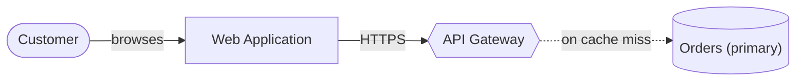

## Label text

Labels follow Mermaid's quoting rules. A label without delimiters is written as is: spaces, commas,
colons, hyphens, slashes, `;`, `#`, `&`, `<`, `>` and `%%` are all plain text inside the brackets,
and surrounding whitespace is trimmed.

A label that contains any of `(`, `)`, `[`, `]`, `{`, `}`, `|` or `"`, or that starts with `/` or
`\`, must be wrapped in double quotes. The quotes are not part of the label. An unquoted label with
one of these characters is refused, and the diagnostic shows the line with the label quoted.

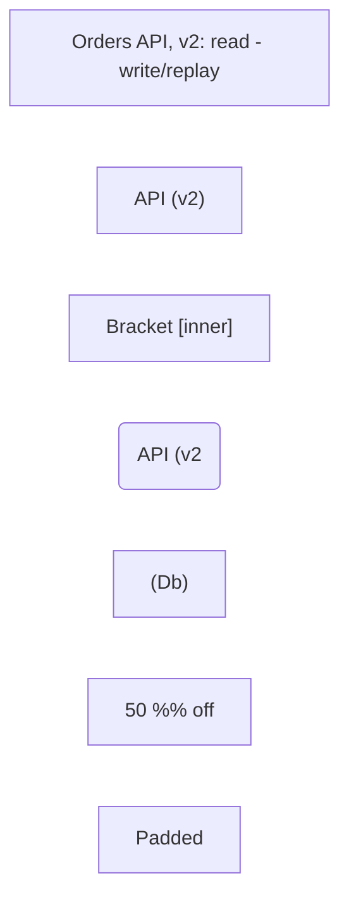

Inside quotes, a double quote is written `#quot;`, Mermaid's entity code for it:
`n["say #quot;hi#quot;"]` is the label `say "hi"`. Mermaid reads every `#name;` and `#123;` in a
label as an entity code and the model holds the character it stands for (see Entity codes), so a
label that must show such text literally writes its `#` as `#35;`.

A delimiter directly after the opening one is a shape, not label text: `x[(…)]` is a cylinder.
Quote the label to keep the text literal: `x["(Db)"]` is a rectangle labelled `(Db)`.

A label is written on one line. `<br/>` in it is a line break, as in Mermaid, which also reads `<br>`,
`<br />` and `</br>`, in any case: the model holds `\n` there and the label is drawn on several lines.
This holds for every label of every diagram type. Other HTML (`<b>`, `<i>`) and Mermaid's markdown
strings (`` "`…`" ``) are refused, and the diagnostic says so: use `<br/>` for a line break; other HTML
isn't supported. An empty label is `expected_label`.

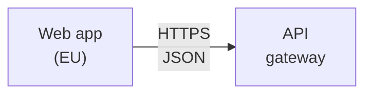

## Edges

Every edge has an explicit stable ID, is directed, and has one source and one target. The ID goes
before the link operator, in Mermaid's form: `source id@--> target`. A label, when present, goes
between pipes after the operator, and is quoted by the same rules as a node label. A two-way link,
`<-->`, `<-.->` or `<==>`, is one edge, with one ID, drawn with an arrowhead at each end: the model
sets `bidirectional: true` on it (absent means one arrowhead, at the target).

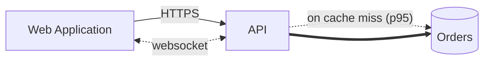

An edge without an ID (`web --> api`) is refused, and the diagnostic shows the line with an ID
added. Edge IDs are what selection, emphasis and comments anchor to, so they must survive edits.
Mermaid pasted from elsewhere has no IDs, so each such diagnostic names its fix, `add-edge-ids`
(`fix.operation`): it writes an ID on every edge that has none, `source_target` (`web_api`), numbered
`_2`, `_3` where that is taken. The same fix declares every node the source only names (an
`undeclared_node` error names it too), at its first mention with its ID as its label (`a` becomes
`a[a]`), so pasted `a --> b` is valid in one step. It also splits a chain into one edge per line,
each from its source's bare ID (`a --> b --> c` becomes `a[a] a_b@--> b[b]` and `b b_c@--> c[c]`);
a chain's diagnostic shows the same split as its hint. Apart from those IDs, declarations and line
splits, no byte of the source changes, and applying it again changes nothing. `validate_diagram` returns the fixed source as
`fix.source` (with `fix.added` and `fix.declared`), as does `archer validate <diagram> --json` as `fix`, and the editor
applies it as the `add-edge-ids` edit.

The link operator sets the edge's `line`:

| Operator | `line`                             |
|----------|------------------------------------|
| `-->`    | `solid` (the default; not emitted) |
| `-.->`   | `dotted`                           |
| `==>`    | `thick`                            |

Longer operators of the same family (`--->`, `-..->`, `===>`, and `<--->` for a two-way link) are
accepted and mean the same line; length carries no meaning in the model. A `<` before any of them
makes the link two-way. An empty or blank label between pipes is `expected_label`;
leave the pipes out for an edge with no label.

### Line patterns and the Key

A line may be dotted, dashed or (a last resort) dash-dot only when it means something the other
lines do not, and the author says what in a comment Mermaid ignores and Archer reads. Archer never
supplies a meaning: a pattern with none is drawn, and its Key row says "meaning not stated".

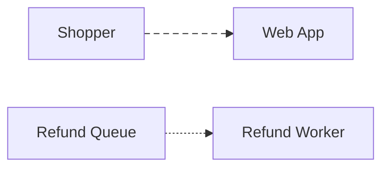

| Pattern   | Flowchart                                                      | C4, architecture, state                 |
|-----------|----------------------------------------------------------------|-----------------------------------------|
| `dotted`  | `-.->`                                                         | `%% archer-line dotted: <edge ids>`     |
| `dashed`  | `class <edge ids> dashed` + `classDef dashed stroke-dasharray: 6 4` | `%% archer-line dashed: <edge ids>` |
| `dashdot` | `class <edge ids> dashdot` + `classDef dashdot stroke-dasharray: 8 3 2 3` | `%% archer-line dashdot: <edge ids>` |
| `thick`   | `==>`                                                          | —                                       |

- `%% archer-key <pattern>: <meaning>` states a meaning once per pattern: at most 4 words and 32
  characters (`line_meaning_text`), one key per pattern (`line_key_repeated`).
- Directives are lowercase, and a directive line is at most 512 characters; a near miss such as
  `archer-keey` or `archer-KEY` is `line_directive_unknown`.
- `%% archer-line <pattern>: a--b, c--d` names edges by the ids Archer gives them, separated by
  commas. An id the diagram does not have is `line_target_unknown`, with the nearest one; an edge
  given two patterns is `line_pattern_repeated`.
- In a flowchart the pattern is Mermaid's own syntax, so other renderers draw the same line:
  `archer-line` there is `line_directive_unsupported`. A pattern class's `classDef` must declare the
  dash above (`line_class_mismatch`); a pattern class on a `-.->` or `==>` edge is
  `line_pattern_conflict`; any other class on an edge is the note `edge_class_ignored`.
- Sequence and ER diagrams already give their dashes a meaning (a reply; a non-identifying
  relationship): `archer-key` and `archer-line` there are `line_pattern_by_notation`.
- Reading rules, as warnings: `line_meaning_missing` (a pattern without a key), `line_key_unused`,
  `line_pattern_everywhere` (every line the same pattern), `line_pattern_last_resort` (dash-dot
  while dotted or dashed is free). `write_diagram` refuses a source that introduces
  one; a file that already has one still compiles.

### Edge labels never hide their line

A caption wraps at about 24 characters, on at most two lines, and the layout keeps line visible on
both sides of it. A label that needs a third line at that wrap is the warning
`edge_label_too_long`; `write_diagram` refuses a source that introduces one. Say it
in two short lines (2 lines of 24 characters) and put the detail in the note. A C4
relationship's technology and description are not counted: they are drawn under the label in
smaller type, the description wrapped on its own.

## Subgraphs

Nested groups use `subgraph id[Label]` followed by `end`. The label obeys the same rules as a node
label, so `subgraph backend["Backend services (core)"]` is accepted. Omitting `[Label]` uses the
group ID as the label. To place a node declared elsewhere in a group, name it by its bare ID inside
the group.

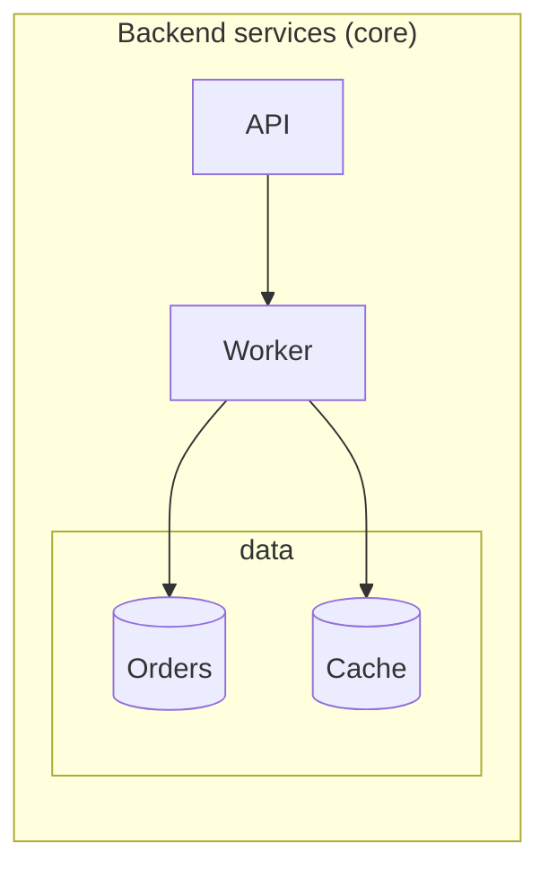

Subgraphs may nest at most 24 levels deep (`subgraph_nesting_too_deep`, at the `subgraph` keyword
opened inside 24 others; checking stops there). A subgraph cannot be an edge endpoint: connect to a
node inside it.

## Kinds and categories

Classes are Archer's vocabulary for what a node is. The six built-in kinds are `person`, `system`,
`container`, `component`, `database`, and `external`. A node gets one inline with `:::kind`, or
from a `class` statement listing nodes: `class a,b person` means the same as `a:::person` and
`b:::person`.

Four kinds have a colour family: `person` violet, `system` teal, `container` green and `database`
plum. `component`, `external` and a node with no kind are neutral, and say what they are in their kind
word. Light and dark values and the rest of the palette are in `DESIGN.md` ("Diagram palette").

A `classDef` defines a further category beyond the six. The Key calls it by its class name as written,
or by the author's meaning: `%% archer-key gpu: Model server on a GPU` (at most 5 words and 32
characters, `category_meaning_text`; one per class, `category_key_repeated`). A line pattern's name keys
the line; a kind keeps its word (`category_key_kind`); an undeclared class is `key_target_unknown`, an
unworn one the warning `category_key_unused`. Key rows follow first use in the source; colour
follows what it declares, never where it is written:

- its `fill`, else its `stroke`, picks the nearest of six families (violet, teal, green, plum, rust, a
  strong dark red) by OKLCH hue; a grey, a cool slate or a very pale tint has no usable hue, so a pale
  fill lets the stroke decide;
- an orange is rust and a red the dark red, drawn solid with white words (consequential); its label
  says what it means;
- blue is the reader's, so a blue takes the nearest other family (violet for an ink blue); amber is
  the agent's, so an amber, or no usable colour, draws neutral;
- a grey whose `stroke` is a light grey is the quiet neutral, receding (a "dropped" box);
  any other grey is the plain neutral;
- any non-zero `stroke-dasharray` gives a dashed outline, in Archer's own dash.

Colours are read as hex (`#rgb`, `#rgba`, `#rrggbb`, `#rrggbbaa`); a fully transparent one declares
no colour, and any other notation (a name, `rgb()`) is the note `category_colour_unread` and draws
neutral. Exact hex values are never reproduced (themes, contrast). Two categories may share a family.
Other properties in a `classDef` are ignored.

A subgraph takes a kind or category with a `class` statement, as a node does (`class gpu1 gpu`;
Mermaid has no `:::` on a subgraph), and like a node at most one. It colours the group's panel, and a
node directly inside it with no colour of its own, or one of the same family, is a light card in that
family's border and words. Anything else inside keeps its own colour.

A subgraph with no kind or category is neutral structure: the outermost is a clear panel with a dark
outline, a nested one a pale panel with a quieter outline, and no colour flows through it to what it
holds.

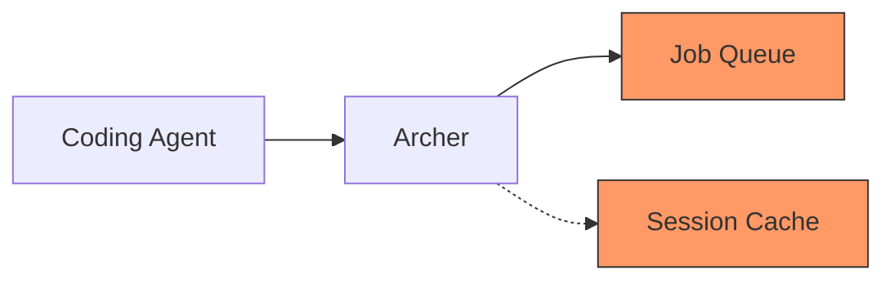

A class that is neither built in nor defined by a `classDef` is the warning `unknown_class`, at the
class name. A class on an edge is a line pattern or nothing; see "Line patterns and the Key". A node has at most one kind or category: Mermaid itself refuses `a:::x:::y`, and a
`class` statement that gives a node a second one is refused.

## Styling

Styling is accepted and ignored, so Mermaid pasted from elsewhere works unchanged. `style`,
`linkStyle`, `click` and `%%{init}%%` directives are parsed and left out of the model, with an
informational note naming what was ignored.

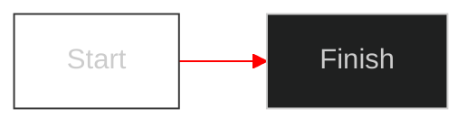

## Refused flowchart constructs

Everything below is refused with `unsupported_construct`, and every such diagnostic names the
supported syntax to write instead:

- shapes outside the table: `(((…)))`, `[/…/]`, `[\…\]`, `>…]`, and Mermaid's `@{ shape: … }`
- a node shape as a subgraph label (`subgraph g[(Store)]`): write `subgraph id[Label]`
- YAML front matter (`---`)
- `direction` statements inside subgraphs
- undirected and open links (`---`, `-.-`, `===`) and invisible links (`~~~`)
- cross and circle link ends (`--x`, `--o`, `-.-x`, `-.-o`, `==x`, `==o`, and two-way `x--x`, `o--o`):
  write the directed link of the same family and put what the ending meant in the label,
  `a fails@-->|fails| b`
- a two-way link with another end (`<--x`, `<--o`, `<---`): write `<-->`, `<-.->` or `<==>`
- inline link text (`-- text -->`, `-. text .->`, `== text ==>`): write the label between pipes
- chained edges (`a e1@--> b e2@--> c`) and `&` node chaining: one edge per line
- a subgraph title without an ID (`subgraph Backend Services`): write `subgraph id[Label]`
- a `;` at the end of a statement
- all other Mermaid constructs

## Diagnostics

Every syntax error carries a source span that starts on the offending line. The same holds for sequence
diagrams.

A warning (`severity: "warning"`) does not stop a diagram compiling: the model is produced and
drawn, `compile.status` is `compiled`, and `read_diagram` and `validate_diagram` list the warning with
its line. An error does stop it.

A source with several problems gets all of them in one report, in source order, so they can be
fixed in one pass: `validate_diagram`, `write_diagram`, and a refused `register_diagram` each list
every one as `[code] line L:C: message`. No model is produced while any problem stands. A
consequence of an earlier problem is not reported as a problem of its own, a source with no diagram
header gets that one problem, and at most 20 problems are listed, the last being
`too_many_diagnostics`.

Where Archer 0.3 wrote something differently, the diagnostic shows the rewritten line (see
Migrating from Archer 0.3).

# Supported Mermaid sequence diagram profile

The sequence parser accepts `sequenceDiagram` as the header keyword (no direction parameter).
Blank lines and `%%` comment lines may precede the header.

## Participant declarations

Participants are declared with `participant id as Label` or `actor id as Label`. Every participant
named by a message, a note, or an `activate`/`deactivate` must be declared somewhere in the file;
one that never is is `undeclared_participant` at the use. The declaration may sit anywhere,
including below the first use, and participants appear in the model in declaration order. `actor`
additionally emits `kind: "actor"`. Declaring the same ID twice is `duplicate_participant`.

Mermaid reads some words as keywords wherever a participant is named, in any case, so these IDs are
refused: `actor`, `participant`, `note`, `over`, `rect`, `box`, `end`, `loop`, `alt`, `else`, `opt`,
`par`, `and`, `critical`, `option`, `break`, `create`, `destroy`, `title`, `autonumber`, `activate`,
`deactivate`, `accTitle`, `accDescr` and `off`. A name that only contains one, such as `endpoint`
or `notes`, is fine.

The alias after `as` is free text running to the end of the line, written as Mermaid reads it:
punctuation is preserved and surrounding whitespace is trimmed. Mermaid keeps quotes around an alias
as part of it, so an alias wrapped in quotes is refused; write it without them.

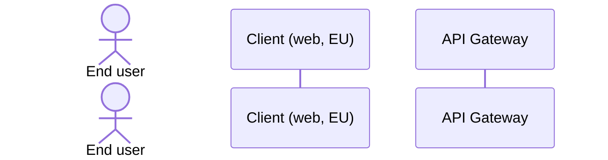

## Message types

Messages use the following arrow syntax between participant IDs:

| Arrow    | Meaning                                  |
|----------|------------------------------------------|
| `->>`    | sync message                             |
| `-->>`   | reply / response                         |
| `-)`     | async message                            |
| `<<->>`  | sync message, arrowhead at each end      |
| `<<-->>` | reply / response, arrowhead at each end  |

A two-way arrow is one message, `kind` `sync` or `reply` with `bidirectional: true`. Mermaid has no
two-way async arrow.

Message text follows the colon after the target participant:

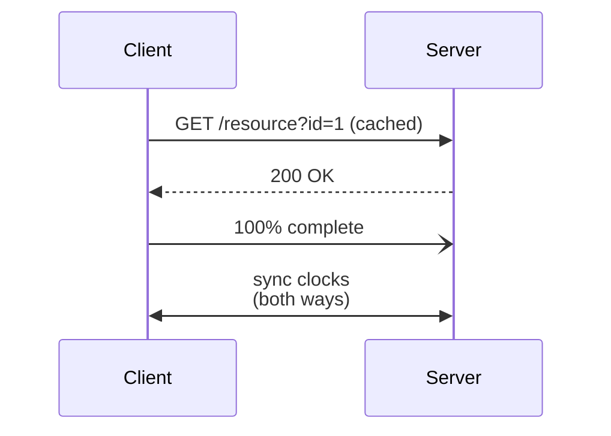

## Text

An alias, message text, note text and fragment label all run to the end of the line, and Mermaid
reads all of it as text. Two characters end the text early in Mermaid, so the profile refuses them
unescaped and the diagnostic shows the escaped form:

- `;` ends a statement: write `#59;`.
- `#` ends the text: write `#35;`.

Entity codes such as `#59;` and `#quot;` are decoded: the model holds `;` and `"`. A `%%` inside
sequence text would become part of the text, so it is refused unless it sits in a quoted span: a
comment takes a line of its own.

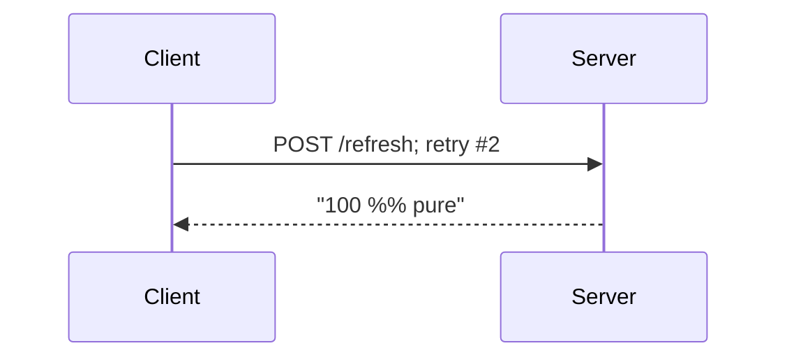

## Activation and deactivation

Explicit activation and deactivation of participant lifelines use `activate participant_id` and
`deactivate participant_id`. Activations may stack, and an activation may be left open at the end
of the diagram. A `deactivate` needs an open activation on the same participant earlier in the
source; otherwise it is `unmatched_deactivate`.

A `+` or `-` directly after any of the arrows is shorthand: `a->>+b: text` is the message
followed by `activate b` (`+` activates the receiver), and `b-->>-a: text` is the message followed
by `deactivate b` (`-` deactivates the sender). The shorthand and the explicit statements share one
count of open activations per participant.

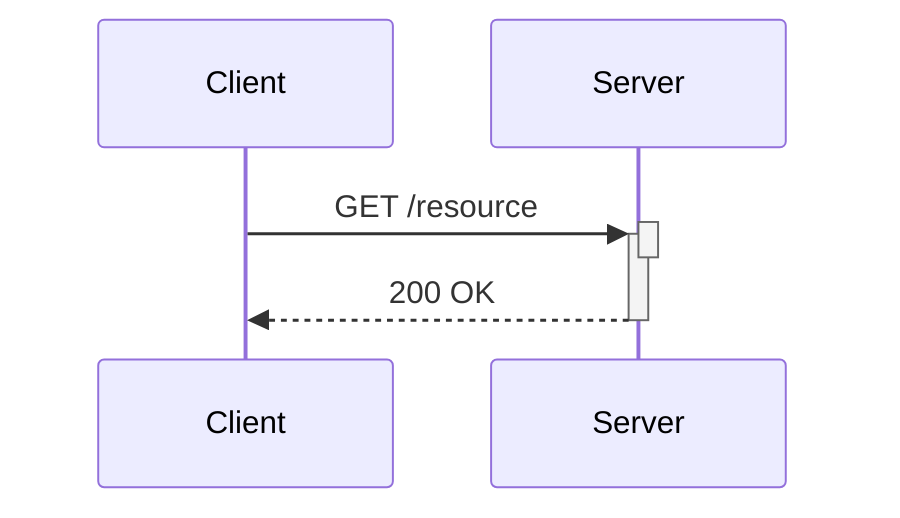

## Notes

A note is free text attached to one or two participants. It becomes a `note` event in the trace, in
source order alongside messages and fragments.

| Syntax                  | `position` | `participants` |
|-------------------------|------------|----------------|
| `Note left of a: text`  | `left-of`  | `["a"]`        |
| `Note right of a: text` | `right-of` | `["a"]`        |
| `Note over a: text`     | `over`     | `["a"]`        |
| `Note over a,b: text`   | `over`     | `["a", "b"]`   |

`Note`, `left of`, `right of`, and `over` are matched case-insensitively, as in Mermaid. Each note
gets a positional ID `note-N`. The text follows the rules under Text; an empty note is
`expected_label`, a missing colon is `expected_colon`, and any other position or participant count
is `invalid_note`.

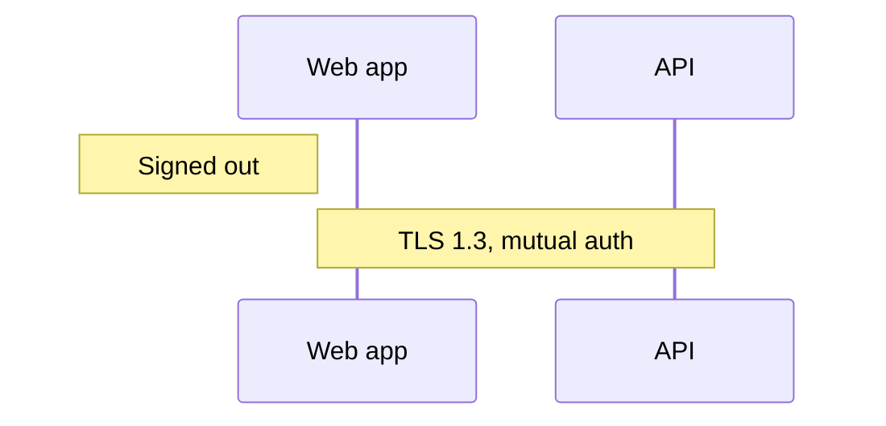

Notes are comments-only targets. Right-click or long press the
sheet, or Tab to its named button and press C, Enter, Space or the context-menu key (Shift+F10).
The About picker names the note text and participants; its pin sits on the sheet and Project Review
can reveal it. `get_comments` includes the current note text, participants and enclosing block.
Notes remain outside published selection, presentation focus and emphasis.

`note-N` is positional. Optional server-owned `sequenceNote` metadata reuses the block identity
contract in comments-sidecar version 6. Unique unchanged notes survive insertion/reordering;
semantic changes, deletion and duplicates orphan safely. Observed duplicate ambiguity stays
permanent. Sibling note changes do not change an enclosing scope's identity for another note;
its block's other semantic contents still participate. A participant ID colliding with a note ID is
an ambiguous comment target and is refused. Legacy files load; older strict readers refuse the
unfamiliar metadata. Schema-v2 diagram envelopes are unchanged.

## Message numbering

A bare `autonumber` statement sets `autonumber: true` on the trace. `autonumber 10`,
`autonumber 10 5`, and `autonumber off` are refused with `unsupported_construct`.

## Fragment types

| Fragment    | Syntax                                 |
|-------------|----------------------------------------|
| Loop        | `loop label` ... `end`                 |
| Alternative | `alt label` ... `else label` ... `end` |
| Optional    | `opt label` ... `end`                  |
| Parallel    | `par label` ... `and label` ... `end`  |

Fragments may nest at most 24 levels deep (`fragment_nesting_too_deep`). Every fragment keyword
needs a label, which follows the rules under Text.

Whole fragments can be commented on from their header or border (right-click, touch long press, or
Tab to the header and press C, Enter or the context-menu key). The About picker includes nested
blocks. These are group comments on the entire block, including all branches and nested contents;
per-branch anchors are deferred. Participants and messages remain the only selection targets.

`frag-N` is positional, so comments keep a separate semantic identity in an optional version-6
comments-sidecar field. Insertion and reordering preserve a unique unchanged block;
semantic edits or ambiguous duplicates safely orphan the discussion. Observed duplicate ambiguity
is permanent for that thread. Older comments files still load; older Archer versions refuse a
version-6 sidecar rather than misreading it. The diagram model remains schema version 2.

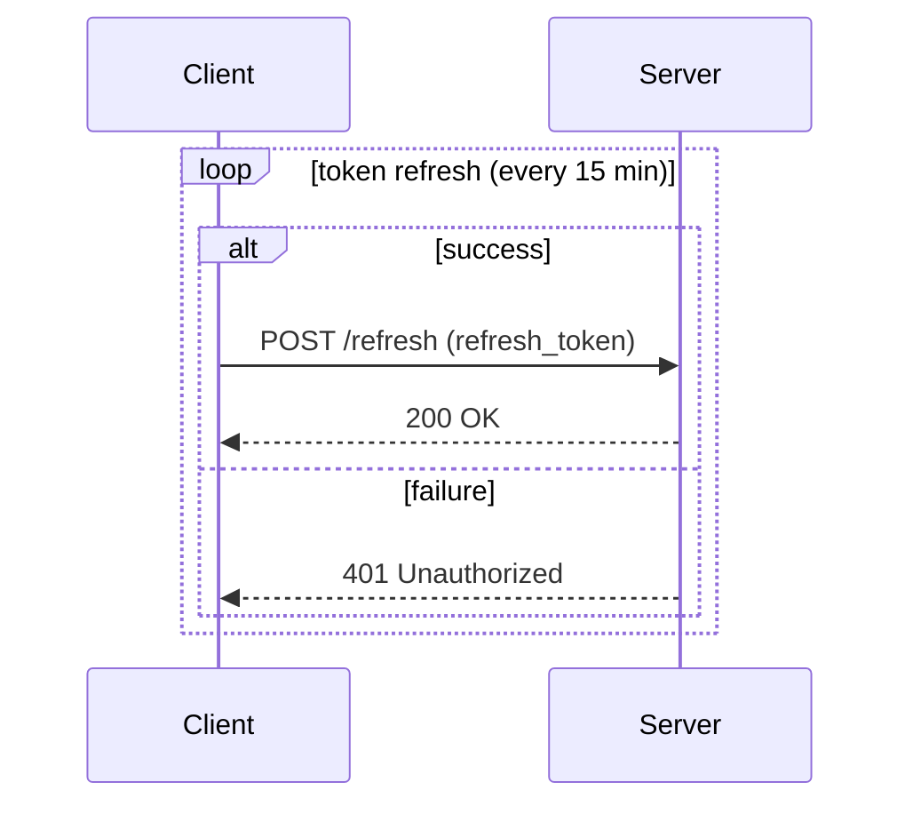

## Styling

`%%{init}%%` directives are accepted and ignored, with an informational note, as in flowcharts.

## Refused sequence constructs

The following are refused with `unsupported_construct`. The source does not compile and
`validate_diagram` reports `valid: false`; a construct is never dropped while the diagram is
reported as valid.

- `rect` background highlighting and `box` participant grouping
- `autonumber` with a start value, a step, or `off`
- `link` and `links` URL attachments
- `create` / `destroy` participant lifecycle
- `critical` / `option` / `break` fragment types
- arrows other than `->>`, `-->>`, `-)`, `<<->>` and `<<-->>`
- `else` inside `par` (use `and`) and `and` inside `alt` (use `else`)
- classes on participants

# Supported Mermaid state diagram profile

The header is `stateDiagram-v2` (or `stateDiagram`, read the same way), alone on its line. The
diagram compiles to a `state-machine` model: its states, each with an ID, a label and a kind, and its
transitions.

## States

Every state is declared, as in flowcharts, so a typo is caught rather than drawn as a new state:

- `state Idle` declares a state whose label is its ID;
- `state "Waiting for Work" as Idle` and `Idle : Waiting for Work` declare it with a label;
- `state Route <<choice>>`, `<<fork>>` and `<<join>>` declare a pseudo-state of that kind;
- `state Working {` … `}` declares a composite state; the states declared and named inside it belong
  to it (`parentId` in the model).

A state named by a transition but never declared is `undeclared_state`. A state takes one label
(`duplicate_declaration`). Mermaid draws nothing for a state that is only declared with `state Idle`
and named by no transition, so that is refused too (`undrawn_state`): connect it, or give it a label.

State IDs are the selection and comment anchors: 1 to 128 ASCII letters, digits and `_`, starting
with a letter or digit (Mermaid itself refuses `-` in a state ID). A state belongs to one place: once
it is written inside a composite state, every transition and note naming it is written there too
(`state_scope`), because Mermaid moves or joins a state named in two places.

`[*]` is the start (as a source) or end (as a target) of the scope it is written in. Its ID is
Mermaid's own: `root_start` and `root_end` at the top level, `Working_start` and `Working_end`
inside `Working`. A state named like one of these is `reserved_id`.

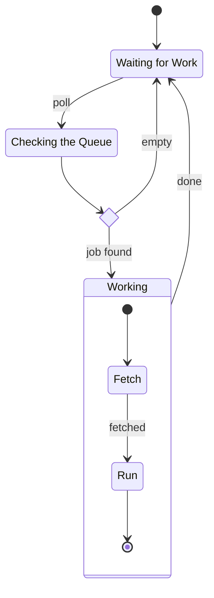

## Transitions

A transition is `A --> B`, or `A --> B : event` with a label. Mermaid has no transition IDs, so
Archer names a transition by its two states: `Idle--Checking`, `root_start--Idle`. The ID changes
only when a state is renamed. A second transition from the same state to the same state is drawn by
Mermaid but cannot have an ID of its own, so it is ignored with the warning `duplicate_transition` at
its line: the first one is drawn and keeps the ID. Write one, with every event in its label
(`A --> B : start / resume`).

`;` ends a statement in Mermaid's state grammar wherever it stands, so a literal `;` in a label is
written `#59;`. Entity codes such as `#quot;` are decoded, as in every label.

## Notes and direction

`note left of Idle : text` (or `right of`) attaches a one-line note to a state; a state takes one
note (`duplicate_note`). `direction LR` (or `TB`, `BT`, `RL`) at the top level sets the model's
`direction`, as a flowchart's header does; absent, the model has none and the diagram is drawn top
to bottom.

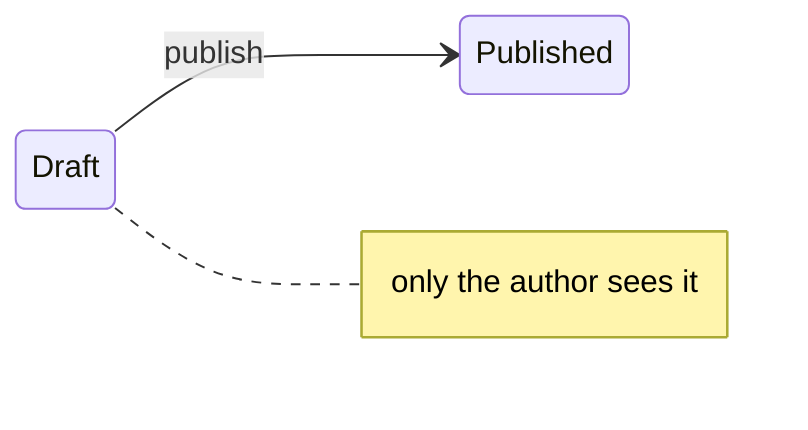

## Styling and refused state constructs

`classDef`, `class`, `style` and `:::name` are accepted and ignored, with one informational
`ignored_styling` note. These are refused with `unsupported_construct`:

- concurrent regions (`--` inside a composite state)
- notes over several lines (`note left of A` … `end note`) and floating notes (`note "x" as N1`)
- `direction` inside a composite state
- `hide empty description`, `scale`, `click`, `accTitle`, `accDescr`
- a `%%` comment after a statement

# Supported Mermaid ER diagram profile

The header is `erDiagram`, alone on its line. The diagram compiles to an `entity-relationship`
model: entities with their attributes, and relationships with a cardinality at each end.

## Entities

An entity is declared on a line of its own: `CUSTOMER`, `CUSTOMER["Customer"]` with a label, or
either followed by `{` and one attribute per line, closed by `}`. An entity named by a relationship
but never declared is `undeclared_entity`. Entity names are the selection and comment anchors: 1 to
128 ASCII letters, digits, `_` and `-`. A quoted entity name (`"Order Line"`) is refused: write
`LINE["Order Line"]` instead.

An attribute is `type name`, then any of `PK`, `FK` and `UK` separated by commas, then an optional
quoted comment. Attributes belong to their entity and have no ID of their own.

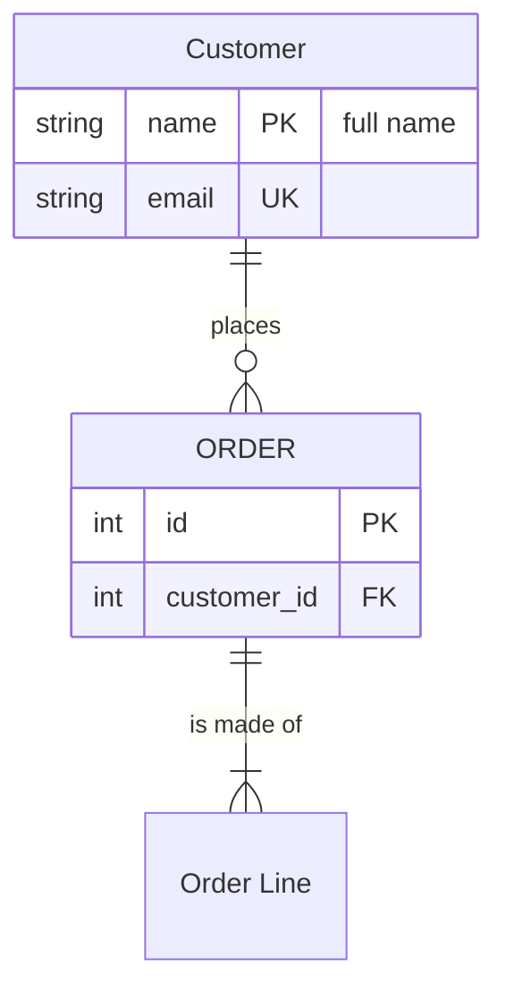

## Relationships

A relationship is `A <marker><line><marker> B : label`. The marker beside the left entity is `|o`
(zero or one), `||` (exactly one), `}o` (zero or more) or `}|` (one or more); beside the right one,
`o|`, `||`, `o{` or `|{`. The line is `--` (identifying) or `..` (not). In the model each
cardinality belongs to the end it is written beside: `sourceCardinality` to the left entity,
`targetCardinality` to the right.

The label is one word, or quoted. Mermaid reads a second unquoted word as another entity, and words
such as `one`, `many`, `to` and `only` as cardinalities, so those are `unquoted_label`, with the
quoted form as the fix. `""` is a relationship with no label. Cardinalities written in words
(`one or more to zero or one`) are refused: write the markers.

Mermaid has no relationship IDs, so Archer names a relationship by its two entities as written:
`CUSTOMER--ORDER`. A second relationship written from the same entity to the same entity is ignored
with the warning `duplicate_relationship` at its line: the first one is drawn and keeps the ID.

```mermaid
erDiagram
    direction LR
    PRODUCT
    LINE-ITEM
    LINE-ITEM }o..|| PRODUCT : refers
```

## Styling and refused ER constructs

`classDef`, `class`, `style` and `:::name` are accepted and ignored. `direction` sets the model's
direction. Refused: `title`, `accTitle`, `accDescr`, cardinalities in words, an attribute block that
is never closed, and a `%%` comment after a statement.

# Supported Mermaid C4 profile

The header is `C4Context`, `C4Container` or `C4Component`, alone on its line; the model is a
`c4-model` with that `level`. `C4Dynamic` and `C4Deployment` are refused.

Mermaid's C4 grammar accepts much that it then reads otherwise or drops without a word: a `Rel`
with no label swallows the next line, a `$tags` argument drops the relationship, a second element
with an alias moves the first. So Archer holds every C4 statement to one exact form, one per line,
and refuses anything else.

## Elements and boundaries

Every argument after an alias is quoted:

- `Person(alias, "Label", "Description")` and `System(...)` likewise, with `SystemDb` and
  `SystemQueue` for a database or queue shape;
- `Container(alias, "Label", "Technology", "Description")`, with `ContainerDb`, `ContainerQueue`,
  and `Component`, `ComponentDb`, `ComponentQueue` likewise;
- an `_Ext` suffix on any of these (`Person_Ext`, `SystemDb_Ext`) marks it external;
- `Enterprise_Boundary(alias, "Label") {`, `System_Boundary`, `Container_Boundary` and the generic
  `Boundary`, closed by `}` on a line of its own, holding at least one element.

Only the alias and the label are required. Aliases are the selection and comment anchors: 1 to 128
ASCII letters, digits and `_`, each used once (`duplicate_id`). An unquoted label is
`unquoted_argument`, with the quoted form as the fix.

```mermaid
C4Container
    title Web Shop Containers
    Person(customer, "Customer", "Buys things")
    System_Boundary(shop, "Web Shop") {
        Container(web, "Web App", "TypeScript", "Serves the pages")
        ContainerDb(orders, "Orders", "PostgreSQL")
    }
    System_Ext(payments, "Payment Provider")
    Rel(customer, web, "Orders from", "HTTPS")
    Rel(web, orders, "Reads and writes", "SQL")
    BiRel(web, payments, "Pays through")
```

## Relationships

`Rel(from, to, "Label", "Technology", "Description")` and `BiRel(...)`, which has an arrowhead at
each end, join two elements (not boundaries); the label is required. `Rel_U`, `Rel_D`, `Rel_L`,
`Rel_R` (and `Rel_Up`, `Rel_Down`, `Rel_Left`, `Rel_Right`) are read as `Rel`, with an
informational `ignored_layout_hint`: Archer lays the diagram out itself. `Rel_Back` is refused:
write the relationship the way it points.

Mermaid has no relationship IDs, so Archer names a relationship by its two aliases as written:
`customer--web`. A second relationship from the same alias to the same alias is the warning
`duplicate_relationship` at its line, and Archer draws what Mermaid draws: one relationship, at the
first one's place and with its ID, whose label and arrow are the later one's, and its technology and
description too where the later one gives them. A relationship naming an alias that is never
declared is `undeclared_element`.

```mermaid
C4Context
    Person(customer, "Customer")
    System(shop, "Web Shop")
    Rel_D(customer, shop, "Buys from")
```

## Styling and refused C4 constructs

`UpdateElementStyle`, `UpdateRelStyle`, `UpdateBoundaryStyle`, `UpdateLayoutConfig`,
`AddElementTag` and `AddRelTag` are accepted and ignored. `title` sets the model's title. Refused:
named arguments (`$sprite`, `$tags`, `$link`, ...), sprites and tags in any position, `Rel_Back`,
`RelIndex`, deployment nodes, an empty boundary, and a `%%` comment after a statement.

# Supported Mermaid architecture profile

The header is `architecture-beta`, alone on its line. The diagram compiles to a
`service-architecture` model: groups, services, junctions and the edges between them.

## Groups, services and junctions

- `group id(icon)[Label]`, with `in parent` after it to nest it in another group;
- `service id(icon)[Label]`, with `in group` to place it in a group;
- `junction id`, with `in group` likewise.

The icon is optional and is one of Mermaid's built-in five: `cloud`, `database`, `disk`, `internet`,
`server`. Icon packs (`logos:aws-s3`) are refused: Archer cannot draw them. A label may be quoted
(`["Client (web)"]`). IDs are the selection and comment anchors: 1 to 128 ASCII letters, digits,
`_` and `-`, one namespace for all three (`duplicate_id`). A group named by `in` must be declared
(`undeclared_group`).

```mermaid
architecture-beta
    title Shop Platform
    group cloud(cloud)[Cloud]
    group data(database)[Data Tier] in cloud
    service gateway(internet)[Gateway] in cloud
    service app(server)[App Server] in cloud
    service db(database)[Orders DB] in data
    junction hub in cloud
    gateway:R -- L:hub
    hub:R --> L:app
    app{group}:B <--> T:db{group}
```

## Edges

An edge is `a:R --> L:b`: each end's side (`L`, `R`, `T` or `B`) is written beside it, and between
them `--`, `-->`, `<--` or `<-->` for the arrowheads. A label goes in the line: `a:R -[audit]- L:b`.
`a{group}` makes the edge meet the boundary of `a`'s group. An edge joins services and junctions.

Mermaid has no edge IDs, so Archer names an edge by its two ends as written: `gateway--hub`. A
second edge from the same end to the same end is ignored with the warning `duplicate_edge` at its
line: the first one is drawn and keeps the ID.

Mermaid also refuses, with no position, an edge that uses `{group}` between two services of the same
group and an edge to an ID declared below it; Archer reports these as `invalid_diagram` with
Mermaid's message.

```mermaid
architecture-beta
    service web(internet)[Web]
    service api(server)[API]
    web:R -[calls]-> L:api
```

## Refused architecture constructs

Icon packs and icon text, `accTitle`, `accDescr`, an edge to a group (use `{group}`), and a `%%`
comment after a statement.

# Supported Mermaid user journey profile

The header is `journey`, alone on its line. The diagram compiles to a `user-journey` model: an
optional title, the actors in the order they first appear, and the sections with their tasks.

```mermaid
journey
    title A Working Day
    section Go to Work
        Make tea: 5: Me
        Go upstairs: 3: Me, Cat
    section Go Home
        Sit down: 5: Me
```

A task is `Name: score` or `Name: score: Actor, Actor`, inside a section; the score is a whole
number from 1 to 5. A task before any section is `task_outside_section`; any other score is
`invalid_score`.

## Task and section IDs

Mermaid's journey syntax has no IDs, so Archer derives them from names, never from positions (a
position would move a comment to another task when one is inserted above). A task's ID is its name
in lower case with each run of other characters turned into `-`: `Make tea` is `make-tea`. A letter
or digit outside A–Z and 0–9 is spelled as its code point: `Café visit` is `caf-ue9-visit`. A
section's ID is `section-` and its name made the same way. Two names that give the same ID are
`duplicate_id`: rename one. Renaming a task changes its ID, as renaming a state does.

Mermaid's journey grammar ends the text at `#` and the statement at `;`, so a literal `#` is written
`#35;` and a literal `;` is `#59;`. Entity codes are decoded, as in every label.

## Refused journey constructs

`accTitle`, `accDescr`, a second `title`, a task outside a section, and a `%%` comment after a
statement.

# Nesting profile

Archer's page draws a diagram with containers in a nested view (experimental, on by default;
`nested_view = false` in the project's `archer.toml` draws every diagram as written) that opens it
one level at a time: a closed boundary, subgraph, group or composite state is one box, its `+`
opens it and the open frame's `−` closes it. A page link can ask for a view: `?zoom=full`, or
`?open=<id>,<id>` for containers already open.
Nesting comes from the file itself, so the profile below keeps it uniform. Its findings never stop a diagram from compiling or drawing. An
agent's `write_diagram` that **adds** warnings below to the source it replaces (more of one code
than the source had) is refused, with nothing written and each new one listed by its line in the
diagram's source; warnings already there are only reported, and renaming what they name is not
adding one.

| Code | Severity | Rule |
|------|----------|------|
| `nest_level_mismatch` | warning | C4: a `System_Boundary` holds containers (or systems, as Mermaid's own samples group them), a `Container_Boundary` components, an `Enterprise_Boundary` people and systems |
| `nest_kind_order` | warning | C4: no `System_Boundary` or `Container_Boundary` inside a `Container_Boundary`, no `System_Boundary` inside another, and an `Enterprise_Boundary` only at the top level |
| `nest_id_clash` | warning | Flowchart: a subgraph does not share its ID with a node |
| `nest_too_deep` | warning | At most 4 containers one inside another; each deeper one is reported |
| `nest_single_child` | info | A boundary, subgraph or group holding a single element adds a level with nothing to see (not reported for composite states) |
| `nest_mixed_root` | info | Flowchart and architecture: more than 6 loose top-level nodes beside a container |

Write each container's declarations inside it, indented one level per container. In C4, put the
relationships after every declaration at the top level; a state diagram's transitions stay in the
composite state they belong to (`state_scope`):

```mermaid
C4Component
    title Web Shop
    Person(customer, "Customer")
    System_Boundary(shop, "Web Shop") {
        Container(web, "Web App", "React")
        Container_Boundary(api, "API") {
            Component(checkout, "Checkout")
            Component(catalog, "Catalog")
        }
    }
    System_Ext(payments, "Payment Provider")
    Rel(customer, web, "Shops with")
    Rel(web, checkout, "Places orders")
    Rel(web, catalog, "Reads products")
    Rel(checkout, payments, "Charges cards")
```

# Limits

Every profile shares these bounds. Each one is a refusal with a diagnostic of its own that says what
the bound is and what to do; nothing is ever cut to fit.

| What | At most | Diagnostic |
|------|---------|------------|
| The source of one view | 262,144 bytes (256 KiB) of UTF-8 | `source_too_large` |
| One label | 512 characters | `label_too_long` |
| Nested subgraphs; nested fragments | 24 levels | `subgraph_nesting_too_deep`; `fragment_nesting_too_deep` |
| Nested composite states; nested C4 boundaries; nested architecture groups | 24 levels | `nesting_too_deep` |
| One ID | 128 characters | `invalid_id` |
| A derived ID (`a--b`, a journey task's) | 128 characters | `id_too_long` |
| One statement line (comment lines are not counted) | 4,096 characters | `line_too_long` |
| One compile in the service | 10 seconds | `compile_timeout` |

Every label of every type (state, transition and note text, attribute names, types and comments, C4
labels, technologies and descriptions, titles, actors) is held to the same rules as a flowchart
label: `<br/>` is a line break, and there are no other HTML tags and no control or
bidirectional-formatting characters.

A label is any free text the profile draws. It is measured in characters after trimming, after
surrounding quotes are removed and after entity codes are decoded; a line break counts as one. A source over the size limit is
not read at all. Neither is a source with a statement line over 4,096 characters, or with blocks nested more than 64 deep
(refused with that family's nesting diagnostic); each is then the only problem reported. A compile that runs past its time in
the service is stopped and refused with `compile_timeout`: split the diagram into smaller views.

# Entity codes

Mermaid reads `#name;` and `#123;` anywhere in a label as an entity code, and draws the character it
stands for: its preprocessor turns `#quot;` into `&quot;` and `#35;` into `&#35;`, and the browser
resolves those as HTML character references. Archer decodes them the same way, so the model holds the
characters Mermaid draws, in every label of every diagram type.

| Code | Drawn | Code point |
|------|-------|------------|
| `#quot;` | `"` | U+0022 |
| `#amp;` | `&` | U+0026 |
| `#lt;` | `<` | U+003C |
| `#gt;` | `>` | U+003E |
| `#nbsp;` | a no-break space | U+00A0 |
| `#35;` | `#` | U+0023 |
| `#59;` | `;` | U+003B |
| `#9829;` | `♥` | U+2665 |
| `#eacute;` | `é` | U+00E9 |

```mermaid
flowchart LR
  a["say #quot;hi#quot; to R#amp;D #35;1"]
  b["5 #lt; 6#59; caf#233;"]
  a e1@--> b
```

The two nodes are labelled `say "hi" to R&D #1` and `5 < 6; café`.

- A name is any of the HTML named character references (`#eacute;`, `#rarr;`, `#hearts;`), with the
  browser's case: `#QUOT;` is `"`, `#Quot;` is not a name.
- A number is decimal. `#0;`, a surrogate and a number past U+10FFFF are U+FFFD; `#128;` to `#159;`
  are the Windows-1252 characters (`#128;` is `€`), as the browser reads them.
- A name the browser does not know is drawn as `&name;`, so Archer holds `&name;`. A name that
  starts with one the browser knows without its `;` is that character and the rest: `#notit;` is
  `¬it;`.
- To show a code literally, write its `#` as `#35;`: `#35;quot;` is `#quot;`.

A decoded label is held to the label rules. A code that stands for a control or
bidirectional-formatting character (`#27;`, `#10;`, `#8238;`) is `control_character`, and codes that
spell a tag (`#lt;b#gt;`) are refused as HTML, as the characters written directly would be; that includes
`#lt;br#gt;`, which Mermaid draws as the text `<br>`, not a line break. Codes
that stand for `<`, `>` and `&` in ordinary text, such as `5 #lt; 6`, are kept.

A journey task's ID is made from its name after decoding: `Caf#233; visit` is `caf-ue9-visit`.

# Migrating from Archer 0.3

Archer 0.3 read its own dialect, which Mermaid refuses. Its forms are now refused, each with a
diagnostic that shows the rewritten line. (`archer migrate`, which rewrote `.mmd` files, was retired
in 0.15.0; so was the hint for the edge-ID-first form `e1@a --> b`, now an `unexpected_token`.)

| Archer 0.3 | Now |
|---|---|
| `x[API (v2)]`, `x(API (v2))` | `x["API (v2)"]`, `x("API (v2)")` |
| `x[Bracket [inner]]` | `x["Bracket [inner]"]` |
| `x[(Orders (primary))]` | `x[("Orders (primary)")]` |
| `subgraph g[Backend (core)]` | `subgraph g["Backend (core)"]` |
| `e1@a -->\|reads (c)\| b` | `a e1@-->\|"reads (c)"\| b` |
| `x[Label] %% note` | `%% note` on the line above `x[Label]` |
| `participant q as "Web (EU)"` | `participant q as Web (EU)` |
| `a->>b: x; y` | `a->>b: x#59; y` |
| `a->>b: text %% note` | `%% note` on the line above `a->>b: text` |
| `participant actor as Actor` | `participant actor_ as Actor`, renamed everywhere |

An ID that Mermaid reads as a keyword is renamed with a `_` suffix (or `_2`, `_3`, … if that is
taken) everywhere it occurs, so anything that referred to the old ID can be updated. Every other ID
and every label is kept as it was.
