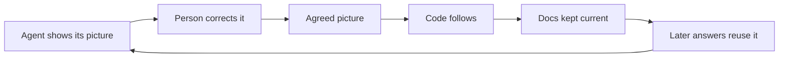

# Intent

**Archer is the shared visual memory of a codebase.** Person and agent agree on architecture, user
flows and data flows through pictures, so wrong ideas show up before the code does, and nobody has
to read a wall of text to get there. What it is for, case by case: [use cases](use-cases.md).

`PRODUCT.md` is the longer brief; where they disagree, `PRODUCT.md` is fixed (decided
2026-10-22). Items marked *(confirmed)* were confirmed; the rest are the agent's draft.

## For whom

- **First:** a developer who thinks visually, works with coding agents on remote hosts, and is tired
  of walls of text. Today that is its own maintainers, every day.
- **In 1.0:** someone who installs it from the guide alone, since it will be open source soon. The
  install path and docs mode serve them. Teams are out of 1.0. *(confirmed)*
- **The agent is a user too:** it writes the docs and reads them back.
- **Later:** teams and reviewers.

## Goals

1. **Agreement with higher assurance, faster, in fewer words.** The person checks the agent's
   picture instead of its prose, and the agent sees the person's the same way.
2. **Catch wrong ideas sooner:** before code is written, in PR review, and where the system as built
   differs from the design.
3. **Docs that stay true and get reused.** "How does X work?" is answered by showing an existing
   diagram with the path emphasised. More detail goes in a copy, and the docs stay as they were.
4. **A low barrier.** One install guide, no accounts, accessible (WCAG 2.2 AA), clear without
   training.

Nice-to-have, not a goal: animation, such as for now versus intended. A static before-and-after
comes first, and reduced motion keeps the meaning. *(confirmed)*

## Non-goals

Each could reasonably be a goal. These are chosen not to be.

- A hosted service, accounts, or any copy of the model outside the repository.
- A wiki regenerated wholesale from the code. Archer keeps a small, checked set of docs.
- A general whiteboard or diagram editor. Mermaid stays the source.
- Team process (roles, approvals) before single-owner use is solid.
- Replacing the repository's README, how-to guides or ADRs. The docs link to them.

## Later

- The phone: "later", not a non-goal. It gets a static picture or the MCP App before the full
  canvas. *(confirmed)*

## Constraints

- Local Mermaid and Markdown, versioned in git. The page reaches agents on remote hosts by a link.
- Desktop first.
- Agents work through MCP tools, a skill and a CLI. People work in a page served by a local
  background service.

## Quality goals, in order *(confirmed)*

1. **Shared understanding:** person and agent see, and agree on, the same picture.
2. **Accurate docs:** never a stale, proposed or broken picture shown as current.
3. **Speed:** quick to grasp and quick to start.
